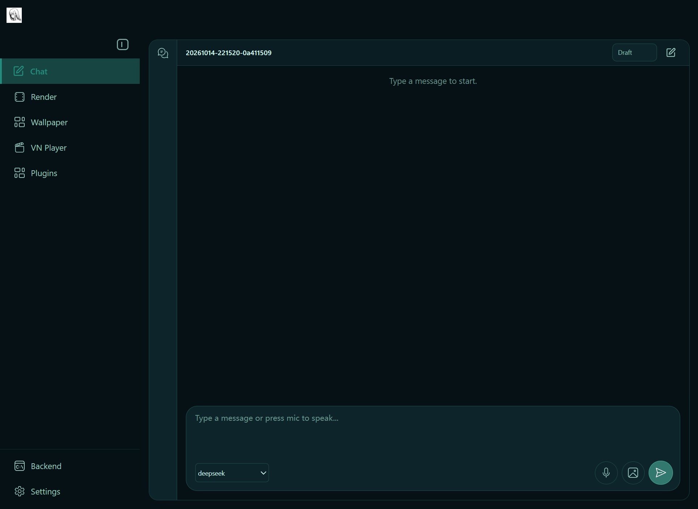
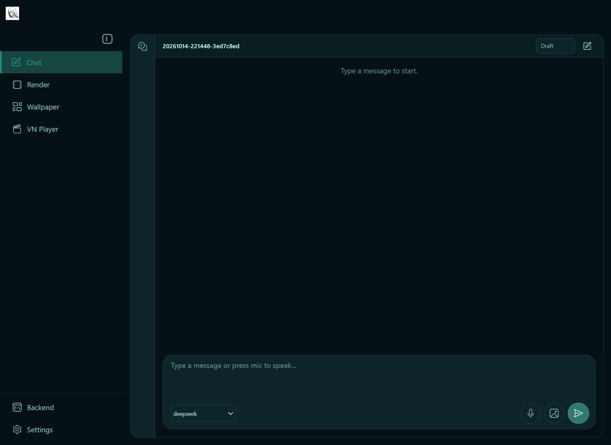

# 0.17.0 Alpha candidate acceptance

Recorded on 2026-10-14 (Pacific/Auckland). Baseline main:
`7815fdf36480367a1cf57c27e2121379e12967f4`; previous release:
`v0.16.1-alpha.0` (`6147acbc36e2b16faa5d8192a873d40a7feb5965`).
The interval has 16 mainline commits before #208 and release preparation.

Release tracker: [#215](https://github.com/Code-Amadeus/Amadeus/issues/215).
Full measurements: [performance evidence](alpha-0.17.0-performance.md).

## Deterministic and desktop evidence

- Main at the baseline has successful Windows Python/Electron, Linux, macOS,
  local-model installation-candidate and ROCm-candidate CI workflows.
- #208 was reconciled with current main at `cbc8167a2a7f1ff748880cc5975c9b001825f540`.
  Both independent test/documentation additions were retained. Adapter tests:
  72 passed. Adapter plus model-less smoke helper tests in a fresh locked
  CPU/development environment: 78 passed. All 14 current-head checks passed; #208 merged as
  `5b3c68e8f2446efb8e322714f298304d4b7f221a`.
- The tracked-source baseline plus sidebar/smoke changes passed 523 Electron
  tests and production TypeScript/Vite build. The existing large-chunk warning
  remains. Local untracked diagnostic tests were excluded from the clean-source
  run; they are not part of the release.
- Real Electron model-less smoke passed, including expanded/collapsed sidebar
  absence of Plugins, retained Settings -> General -> Manage plugins navigation,
  encrypted settings, native theme recovery, project/file navigation and complete
  Electron/backend exit. The same checks passed on the unpacked Windows executable.
  No LLM turn, microphone, character asset, external MCP or wallpaper mount was used.
- Native previous-release upgrade from `v0.16.1-alpha.0` preserved settings,
  encrypted credentials, independent provider roles and startup preference.
- Tracked-source Ruff, architecture views and provenance release-ready validation
  passed. The initial development-tree source scan had zero scan errors/warnings;
  its dirty status was correctly non-releasable. Final candidate archive checks
  must use a committed clean selected tree.
- The fresh `uv sync --locked --extra dev` CPU environment passed the environment
  verifier. The existing voice/model installation was not replaced.

The initial sandboxed test attempts hit Windows temporary-directory/process
restrictions; the same targeted fixture passed outside that restriction. Those
attempts are not product regressions or passing release evidence. The development
worktree's full Python runner completed all 472 suites successfully: 5,982 passed,
18 skipped, with five expected failures reported by pytest. Unrelated render/asset
edits appeared in that checkout during the run, so this is supporting diagnostic
evidence; isolated candidate tests and exact-head CI own release certification.

The initial clean candidate `bd10baf2437f494887fefe787fb2ccc3668760e0` passed the
source archive gate (4,099 selected files, zero errors/warnings). Every ZIP file
hash and the embedded manifest matched. Its fresh frontend install passed all
523 tests and production build; its isolated CPU GUI passed all 15 checks.
That archive predates #213. The final candidate must regenerate the manifest/ZIP
and pass source-release CI after incorporating the audio repair.

## Dependency audit disposition

The clean locked CPU/development environment reported no known vulnerabilities
after the existing narrow `PYSEC-2026-1845` exemption (two advisory identities
ignored). Electron retains eight moderate build-tool findings and no high or
critical findings. Pi 0.86.1 still installs brace-expansion 5.0.9 through its
upstream shrinkwrap: one high-severity package, three denial-of-service advisories.
Targeted `npm update` and `npm audit fix --package-lock-only` did not change this
installed contract; no ineffective lockfile edit or broad suppression was retained.
See the [prior disposition](alpha-0.16-acceptance.md#dependency-audit-disposition).

The existing local environment, which also contains optional model/voice/RAG
packages, reported 17 advisory entries in eight packages (including duplicate
identities), with two ignored identities. This is an audit of that installed
environment, not proof that every version matches the current optional lock.
The affected names were accelerate, flash-attn, hydra-core, nltk,
pytorch-lightning, sentence-transformers, transformers and werkzeug.
No optional-model bulk upgrade or new vulnerability-free claim is made.

## Open PR and issue triage

| Item | Release treatment |
| --- | --- |
| #208 | Merged after 72 adapter tests and all 14 current-head CI checks passed. |
| #199 / #213 | Maintainer re-review accepted the bounded output retry; 98 focused tests passed with no skips. Shared-native cases are wired into Windows L2, macOS and Linux voice CI. #213 merged at `fd145ee29454389dcade8c64712b1ebeeb349079`; #199's contribution and authorship are retained. Actual macOS/AirPods reconnect remains unqualified. |
| #185 | High-priority Windows wallpaper input/recovery defect. Do not mark fixed or promise reliable wallpaper operation without targeted reproduction/acceptance. |
| #207 | High-priority sequential Codex/MCP ownership defect. Do not conflate approval repair, Work completion and graceful connection cleanup. |
| #201 / #103 | Rendering acceptance and wider-device/resource claims remain open; retain static compatibility and bounded published claims. |
| #194 | Keep extension integration provisional and sidebar hidden; retained code/settings are not a marketplace release. |
| #195 / #196 / #193 | Their implementation PRs #197/#198/#189 are already on main; open design issues do not mean those changes are unmerged. Verify acceptance before closing records. |
| #23 | Earlier comments report the handoff fix verified and PR #36 submitted; the still-open observation issue alone is not proof of a new 0.17 regression. |
| #39 | Defer the transformers 5.x upgrade; its checks fail and local-model compatibility needs separate qualification. |
| #43 / #146 / #98 / #99 / #97 | Defer broad/old provider, memory and continuity branches; #99 explicitly says it is a reference snapshot, not mergeable work. |
| #123 | Current status-query code includes elapsed/silent durations, liveness, last tool and provider-silent uncertainty; stale-evidence tests exist. Preserve real conversational acceptance rather than assuming the historical failure still reproduces. |
| #190 / #142 / #110 / #64 / #61 | Feature, platform or longer acceptance work; retain the existing scope and avoid treating this release as completion. |
| #176 / #81 / #6 / #4 | Historical release/community tracking; not independent code merge blockers. |

No issue or contributor PR was automatically closed by this triage.
AirPods reconnect, sustained wallpaper interaction, multi-monitor behavior,
exclusive MCP cleanup and broader GPU/device qualification remain outside the
model-less acceptance evidence above.

## Live product acceptance

Tracking: [#215](https://github.com/Code-Amadeus/Amadeus/issues/215); candidate
[#214](https://github.com/Code-Amadeus/Amadeus/pull/214). **Not release-accepted.**
The short-path generated-app run completed all control stages; its retained raw
report failed only an inapplicable spoken-progress check in no-TTS mode. A separate
offline re-evaluation with the repaired reviewer passes all 29 control checks.
The GUI/local-voice reactor repeat passes after repairing the example's stability boundary. The first Gomoku
round failed; a repeat completed gameplay/history but retained an automated
wording-oracle failure, manually reviewed below. No merge, tag or public Release is authorized before maintainer re-review.

These runs used Windows 11 x64, Python 3.12.10, the shipping Electron GUI where
specified, DeepSeek `deepseek-v4-flash`, and the real Codex App Server 0.154.0; the second full journey selected Pi
for adaptation after Codex created the game.
Tasks, sessions, project directories and desktop output were isolated and synthetic.
Voice used existing local models on RTX 4070 Ti SUPER, Torch 2.6.0+cu124 and
Transformers 4.57.6. Raw reports remain local; the committed
[sanitized record](evidence/release-0.17.0/live-acceptance.json) includes report
hashes, boundaries and the tested product-patch hash.

| Real path | Result | What it establishes |
| --- | --- | --- |
| Native Codex permission deny | 8/8 checks | Actionable card, durable deny, same run/attempt continuation, no denied write, terminal completion. |
| Chat → Work status and native steer | 10/10 | Status starts no second run; amendment reaches the same run; one WorkItem/attempt; exact `STEERED` result. |
| Work create/amend/scratch/restart | 23/23 | Real `phase-one` → `phase-two` → restart → `phase-three`, independent scratch, durable project focus, host-owned diff and completion facts. |
| Work cancel/retry | 6/6 | Cancel an actually running native tool, persist `cancelled`, retain one WorkItem with a new successful attempt and exact output. Two bounded writes were approved once. |
| Native Preview → AUIP → leave/thaw | 15/15 | Same real Windows surface; fixture-seeded Work/app, no real authoring provider. |
| Native shell close | 15/15 | User-facing window close and Host lifecycle agree; fixture-seeded Work/app. |
| Implicit AUIP surface creation | 17/17 | Attach opens the correct shared native surface without an earlier Preview open; fixture-seeded Work/app. |
| Reactor AUIP interaction | 22/22 semantic checks | Official seeded example, real model/GUI: legal cooling, accepted receipt before visible role delivery, grounded state query, leave, ordinary Chat. This example declares no AUIP reset action. |
| Reactor GUI + local TTS | 24/24 semantic checks | Real model decisions, accepted receipt before visible delivery and speech, complete TTS lifecycle, grounded query, leave and ordinary Chat. Final sample stays inside its declared safe interval. No microphone or acoustic loopback. |
| Local TTS playback/interrupt/recovery | 5/5 | Actual nonzero PortAudio device writes, interrupt before completion, epoch advancement, no stale writes, and subsequent speech. Production TtsHandler is used. No microphone or acoustic loopback. |
| Local ASR Graph replay | Execution and paired consistency pass | A synthetic 3.456-second local WAV; 384-token Graph, cache hit, 16 replay steps, no fallback. One warmup and one measured call per engine have identical official/Graph text and tokens. |
| Generated lights, full GUI | 29/29 control checks after offline re-evaluation | Real creation, status, same-Work adaptation, attach, two accepted actions, query, reset, leave and ordinary Chat. Raw report remains failed solely for the repaired no-TTS spoken-progress condition. No claim of Provider speech. Earlier timeout and long-path failures remain recorded. |
| Gomoku full round | Failed | First explicit move and four automatic replies were accepted. At revision 11 / move 10, the fifth automatic reply failed with `b2_candidate_not_available`; no unauthorized move executed. Post-round/history checks were not reached. |

ASR consistency is not an accuracy pass: both routes returned
`再開できた。本性の確認はこれで終わり。` for TTS input
`再開できたわ。音声の確認はこれで終わり。`. The shared mismatch cannot be attributed
to CUDA Graph, or separated into TTS/ASR error without acoustic review. The small
probe is not a new performance benchmark; published comparisons and their full
baselines are in [performance evidence](alpha-0.17.0-performance.md).

The Gomoku repeat completed a nine-move round, restart, automatic first move,
resignation, finish-experience, leave and all seven history/capsule checks.
Its raw report remains `failed` only for two grounding checks driven by the same
wording matcher: it recognizes `対局は終わ` but misses `対局はすでに終わ`.
Manual review confirms that the reply's white winner, completed game, resignation
and one remaining stone match the accepted post-restart state. This is a
wording-oracle false negative, not evidence of an incorrect answer; the raw report
was not rewritten and no phrase-specific alias was added.

The first Gomoku failure remains open. Three later real choices at the captured board
returned legal candidates, but used empty branch history and executed no app
action. They neither reproduce the exact failed request nor clear the full-round
failure. Do not add a silent retry or weaken candidate validation to count it as a pass.

### Failures retained and repairs

- **Product authority boundary:** a coarse role-level AUIP proposal could be
  dispatched even when the source-local decision contained no control/read.
  `None` reached the action router and caused `TypeError`. Such proposals now
  reuse the existing entry-refusal path, recording and presenting the refusal
  without creating an action. A new regression fails before the fix; 162 related
  routing, read, action, launch and independent-Work tests pass after it.
- **Work test entry:** the old combined “switch context and create” prompt opened
  a legitimate selection card. The harness now binds the project through existing
  `session.create(project_id=...)` before requesting Work; all 23 real checks pass.
- **Preview fixture:** Attach correctly rejected missing Host SDK hash receipts.
  The fixture now stores the hashes returned by real materialization. All three
  native surface runs pass; a contract test also rejects changed SDK bytes.
- **TTS probe:** the first probe called only pipeline/playback interruption and
  missed sentence-sequence reset. It is retained as a test-instrument failure;
  using the complete production TtsHandler passed actual interrupt/recovery.
- **Full-journey timeout reporting:** a started adaptation timeout used to record
  “no prerequisite run required” and a misleading per-turn business-success flag.
  It now fails immediately once a Provider run exists, in every journey layer.
  The first overall run was already failed; its old per-turn success flag is not evidence.
- **No-TTS review condition:** spoken Provider progress is now required only when
  TTS is enabled. Four tests cover both modes and presence/absence of progress;
  two fail before the fix. The original lights report is unchanged; the separate
  offline review reconstructs source event indices and passes all 29 control checks.
- **Reactor example semantics:** two GUI/voice runs reached 42 and reported
  stabilized despite declaring a 44–70 safe interval. Refreshing the test's
  post-speech snapshot did not solve it. Executing the sample's real clock in Node
  reproduced both legal cooling levels ending at 42 and 37.5. The example now
  holds the safe target during stability confirmation and reports a steady
  terminal trend. Both runtime cases and the real GUI/voice repeat pass. The test
  also refreshes Host state after speech; short controller leases retain their
  separate early activation evidence.
- **Other setup/negative results:** incompatible CLI flag combinations failed
  before launching the product; a long nested Windows path failed Git setup and
  was replaced with a shorter isolated path. Reactor correctly rejected a second
  operation after all cooling choices became unavailable. Its missing AUIP reset
  capability is separate from the no-control crash above.

Microphone/VAD/acoustic barge-in, AirPods reconnect, wallpaper recovery (#185),
exclusive MCP lifetime (#207), wider-device rendering (#201/#103), and consistently
successful repeated generated-app/Gomoku journeys remain unqualified. The full
generated-app run disabled TTS; combined speech coverage is the seeded reactor path. Passing
packaging/CI gates does not supersede these recorded live-product results.

## External review follow-up (2026-10-15)

The eight review findings are addressed in this candidate, without importing the
uncommitted video-distribution work from the development checkout.

| Finding | Candidate change and verification |
| --- | --- |
| Unknown Codex server request kills the SDK reader | Return the SDK's empty result and log only the unsupported method. Two local-peer tests exercise the real 0.154 reader and subsequent request; both fail before the fix. Full adapter suite: 74 passed. No model or real Codex process is used by the transport probe. |
| Video package distribution overstatement | Release title now emphasizes local voice and Work. The notes explicitly state that official assets do not yet distribute video packages and current public packages use static frames in auto mode. |
| Hidden sidebar breaks extension settings smoke | Navigate through General → Manage plugins; remove Sidebar from the Settings fixture. Real Electron smoke: 8/8; now wired into Windows Electron CI. |
| Extension initialize reports old Host version | Read `importlib.metadata.version("amadeus")`; retain the separate Host API compatibility version. Extension/resource tests: 46 passed, including the initialize assertion. |
| README claims wallpaper starts by default | Both READMEs now document control-panel/window default and explicit wallpaper opt-in, with #185's limits. |
| Source archive documentation links | Include `frame_video_candidate.md` and `tts_nested_kv_evaluation_2026-10-14.md`; historical evidence/media references use fixed public commit URLs. Both requested text-document links resolve within the selected source tree. Existing separately distributed README media exclusions are unchanged. |
| Plugin documentation points at hidden sidebar | Host profile and extension examples now point to Settings → General → Manage plugins. |
| Redundant idle-time resets | Compute quiet time directly from the speech-end timestamp; remove the misleading writable counter. Silent Work completion keeps the existing speech-based timing. Nine ambient scheduling tests pass, including that boundary. |

Final live-driver, sample and release-tool verification: 110 passed, including
the six new voice-mode/sample cases. The updated frontend still passes 523 tests
and production build. GPU benchmark
results remain historical measurements, not results fabricated from these tests.

## Sidebar comparison

Isolated empty model-less sessions, with no user conversations or credentials.

