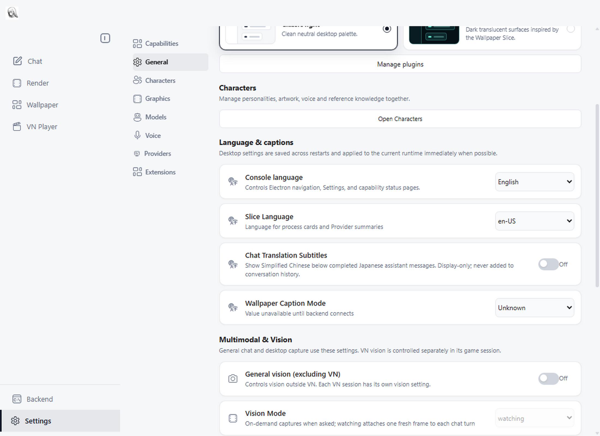
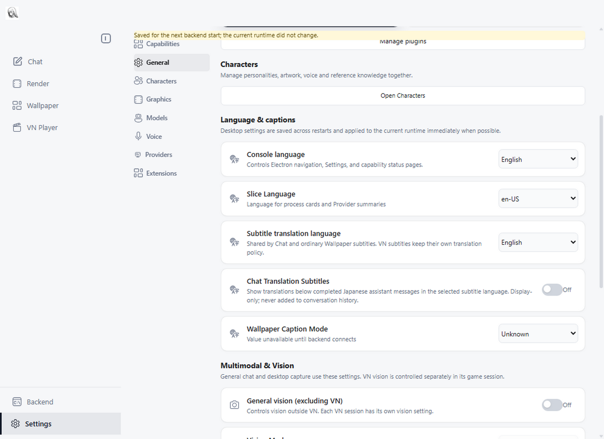

# Shared subtitle target language

The existing Chat/Wallpaper translator now offers Simplified Chinese (the
unchanged default) and English in Settings > General > Language & captions.
VN translation remains separate, including VN captions rendered on Wallpaper.

The images use hidden Electron windows with isolated synthetic settings and
network access blocked. The before image shows the pre-change local build;
the after image shows this branch with English selected. The offline save
notice indicates that no backend was attached to this screenshot profile.

| Before | After |
| --- | --- |
|  |  |

Validation covers both languages across the existing DeepSeek, OpenAI-compatible
and Gemini request paths using synthetic provider responses. Chat's real effects
are exercised with cached and delayed translations during a language switch.
Wallpaper cache tests cover old successes, failures and tasks queued before a
switch. The offline settings smoke exercises persistence and the Host application
policy. No live translation-model quality assessment is claimed.
