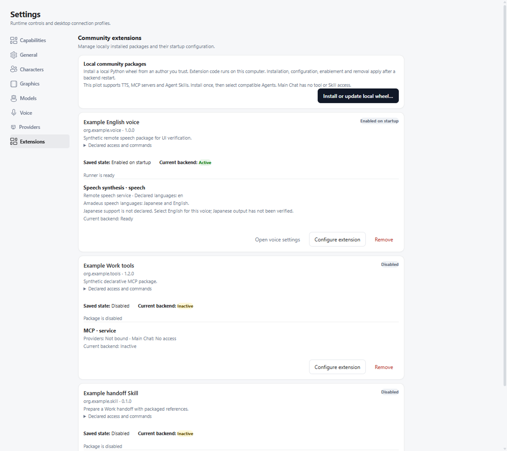
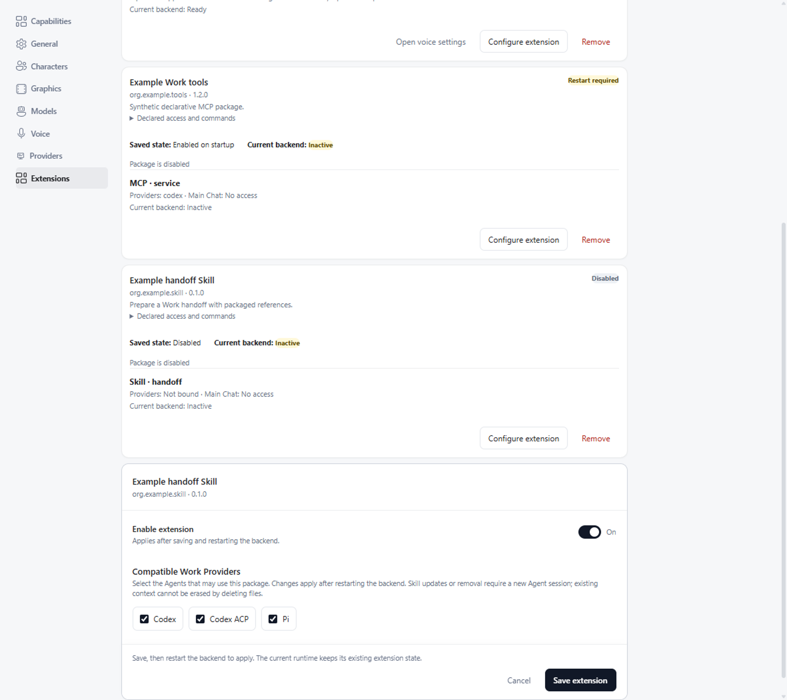

# Experimental extension Host profile 0.1

Status: implemented experimental subset.
Authoring entry updated 2026-10-21; runtime contracts retain their recorded pins. This document describes what this checkout actually accepts;
it does not upgrade the broader Extension Protocol v0.1 draft or its provisional
TTS/MCP/Skill/theme contracts to a stable SDK. The schema is wider than this profile.

Start with [Extension authoring](extension_authoring.md) for the minimal checker environment,
examples and the distinction between protocol, Host support and catalog review.

## Supported contribution owners

| Contribution | Native owner | Public authoring interface |
| --- | --- | --- |
| `voice_backend`, role `tts` | Host TTS proxy + separate Runner | `amadeus-extension-sdk==0.1.0`, `amadeus.voice.tts/v0` |
| `mcp_server` | Selected compatible Work Provider | Declarative MCP command/arguments/environment; native MCP protocol |
| `skill` | Selected compatible Work Agent | Packaged `SKILL.md`, description and relative resources |
| `theme` | Electron main + trusted desktop renderer | Data-only palettes and bounded images; `amadeus.ui.theme/v0` |

`permissions.host` must be empty. ASR, context sources, observers, proactive
execution and third-party executable UI contributions are rejected. No Grant records are
created. OS permission declarations disclose intent; they are not an OS sandbox.
Main Chat receives neither MCP execution authority nor installed Skill bodies.
Notes MCP stores its own notes and has no Amadeus memory/history authority.

## Installation, versions and activation

Electron main owns local-wheel installation, private Python environments,
desired records, encrypted secret storage, explicit version updates and removal.
The Host carries one SDK wheel in `vendor/extension-sdk`, selected by
`server/extensions/protocol-source.json` (source commit, version, filename and
SHA-256). Normal frontend builds verify its bytes with Node and need no Python
SDK build. Packaged Electron ships the same wheel in `resources/extension-sdk`.
Installation checks direct SDK requirements using Python dependency semantics,
including active environment markers, before pip. Compatible ranges and exact
pins are accepted; incompatible constraints and SDK direct URLs get explicit
errors without exposing URL credentials. Transitive dependency conflicts remain
pip resolver errors. Installation stages and verifies the local SDK bytes; it
never downloads or builds an SDK from a third party.
The manifest and referenced package files are checked before importing code.
The wheel's `amadeus.extensions` entry point names the package containing
`amadeus-extension.json`; a TTS manifest additionally names its Runner object.
All six [examples](../examples/extensions/) are validated against these rules.
New `runtime.kind=none` wheels contain resources only: their inspected package
directory is extracted without creating a venv, invoking pip or importing code.
They cannot declare `Requires-Dist`. Existing no-code installations retain their
previous private-environment layout until explicitly updated.

The Host's support matrix lives in `server/extensions/profile.json`; Electron
uses its checked generated copy. It controls contribution acceptance, selection
and Agent-binding requirements, not dynamic imports or execution authority.
Saved package revisions advance only after a real, committed change. Runtime
status reports the revision of each validated startup snapshot separately from
contribution health; Electron never treats a saved revision as an acknowledgement
from the backend. Reading older records supplies initial revision 1 without
rewriting them.

A fresh backend launch retires previous logical loaded revisions even when
child-process exit was not confirmed. This never authorizes deleting files;
cleanup still requires confirmed shutdown. A Host-generated `startup_error`
settles the attempted revision without marking it loaded or requiring endless
restarts; newer edits remain pending. Frontend-only validation or removal errors
do not create backend-restart work. POSIX resource extraction retains executable
bits for bundled MCP commands, but never archive setuid/setgid permissions.

The manager shows package identity, author-declared license (or Not declared),
full wheel SHA-256, local source filename, contributions, commands and OS disclosures
and asks for confirmation before preparing an installation/update or enabling
a package. Updating an enabled package requires fresh confirmation.
Use **Settings → General → Manage plugins** for the complete lifecycle.
Settings → Extensions renders the same manager and records. Voice and Appearance settings
link to it; selection remains in the relevant settings page. Update confirmation
highlights new or changed contributions, commands and OS access.

These baseline screenshots use synthetic packages and the production manager
components; the 0.17.0 sidebar entry is hidden while integration remains provisional:

The backend reads one startup snapshot. TTS/MCP/Skill installation, configuration,
bindings, voice selection, enable/disable and removal apply after backend restart.
Manifest labels cannot override that boundary. There is no live configuration
notification or rolling TTS handover.

Pure frontend theme packages apply immediately and never mark the backend for
restart. If either the old or new package includes a backend contribution, the
whole package switches at the backend boundary. Until then, the theme reads
the old accepted manifest, path and configuration. The manager distinguishes
saved and loaded versions/revisions from health and cleanup errors.
Disabling/removing a mixed package immediately closes frontend admission and
falls back to the theme base; its old backend may still be running. Re-enabling
does not reopen the old frontend before a new startup acknowledgement.

An update prepares a new environment, validates it, then commits the desired
record; compatible configuration/secrets and bindings survive. Backend installation
references, including an in-flight startup snapshot, survive until confirmed
shutdown. Superseded pure frontend resources are collected after application. Removal
defaults to keeping package data; explicit data deletion is a separate choice.
Reinstall does not restore activation, bindings or removed credentials.
Unavailable saved TTS selections remain visible and use text-only behavior.
Host/Python incompatibility or an unavailable validator never deletes installed
records, encrypted credentials or installation references. Validation runs
asynchronously; incompatibility blocks activation while retaining update/removal.
Transient deletion failures retain ownership markers for the next cleanup.

Runner crash recovery is separate from configuration application: it stays
inside the process-lifetime proxy, is bounded, and never repeats failed TTS
requests. Installation trust is not reconstructed by scanning directories.

## Data-only desktop themes

Build the [desktop theme example](../examples/extensions/desktop-theme/) and
install its wheel from Settings → General → Manage plugins. Enable it, then choose Quiet day or Quiet night
in **Settings → General → Appearance**. The example has no dependencies and
runs no package code. Themes do not enter the Work capability catalog or a Runner.

The builtin base remains `data-theme=classic|wallpaper-slice`; the qualified
package selection uses `data-theme-extension`. Component selectors, native
title bar and color scheme continue to follow the builtin base.
`electron/src/shared/themeTokens.generated.ts` publishes allowed tokens,
generated from the pinned protocol `theme-tokens.v0.json` allowlist; only their
default values come from the actual base CSS. Danger, warning and success tokens are
reserved. Only literal colors and installed font families are accepted; CSS
URLs, variable references and declarations are rejected.

The Host validates the same normalized palette it sends to the renderer.
Normal text and accent links must retain contrast of 4.5; muted/faint text at
least 3 across canvas, surface, alternate surface and their interaction overlays.
Reserved status foregrounds must retain 4.5 both directly on those surfaces and
on their own status fills. Surface and alternate-surface colors must be opaque;
the VN editor uses a surface inside dialogs instead of repeating a translucent
canvas. Relative luminance must stay at least 0.5 for classic and at most 0.1
for wallpaper-slice across all three base surfaces. An image background is
proved over its complete possible RGB range after dimming/compositing, including
interior minima. The Host derives a private `--on-accent` black/white foreground
that passes 4.5 on both accent fills; packages cannot set this extra token.
Borderline cases whose contrast cannot be proven are rejected before committing
a desired record. These checks qualify extension palettes, not the unchanged
built-in themes; the example explicitly overrides faint text and interaction
fills that otherwise inherit the older built-in defaults.

Press Ctrl+Shift+F12 (Cmd+Shift+F12 on macOS) in the main window to restore and
persist classic through Electron's native key handler. The Windows wallpaper
tray also offers Restore built-in theme. Neither uses package fonts or rendered
controls. An explicit launch-environment theme override remains authoritative;
a native error explains how to remove it if it prevents saving the reset.

Backgrounds are package-relative PNG/JPEG, at most 8 MiB and 4096 pixels
per dimension. Main validates paths, headers and native decoding; only bounded
bytes and MIME enter the renderer. No package filesystem URL or custom URL
scheme is admitted to the main window. Switching releases the previous style
and Blob URL. Invalid updates preserve the previous installation and selection.

An unavailable selected theme retains its saved identity and falls back to the
last verified builtin base, with a reason shown in Appearance. Reinstalling
never silently enables it. Uninstall defaults to keeping package data, with
explicit deletion available; cleanup failure remains owned and retryable.

## TTS wire and SDK contract

The public [SDK README](https://github.com/Code-Amadeus/Amadeus-Extensions/blob/49449a0f3572e74ac7269129c02c5b9a9e685bef/sdk/python/README.md) is the authoring entry for the pinned version.
An `Extension` registers exactly the TTS IDs declared by the manifest. The Host
compares registration with the manifest before accepting `ready`.

| Wire operation | Implemented behavior |
| --- | --- |
| `initialize` | `amadeus.extension-rpc/v0`, Host/package/activation metadata, initial config/secrets/paths, empty grants |
| `ready`, `contribution.health` | Runner readiness and bounded per-contribution health |
| `tts.synthesize` | One utterance; mono PCM16 little-endian chunk stream, constant rate per request |
| `$/cancel`, `$/ping`, `shutdown` | Cooperative cancellation, liveness and cleanup |

SDK inputs are `utterance_id`, `text`, `language`, advisory `speed` and optional
`deadline_ms`. The synchronous generator yields `AudioChunk`; rate is 8–48 kHz,
each chunk is at most 1 MiB, and at most two requests run concurrently. Wire
lines are bounded to 8 MiB. Use `context.on_cancel` to release blocking I/O and
`context.check_cancelled`; bound network timeouts and close resources in `finally`.
Context config/secrets/paths are read-only startup snapshots. TTS does not own
playback, subtitles, role language, interruption policy or fallback selection.
Cancelled work immediately stops reaching playback; late audio is discarded.
Pending cancellation responses occupy the two-request limit until completion
or process exit. Cooperative cancellation has a 10-second cleanup grace period;
completion within it preserves the Runner and restart budget. An overdue
cancellation terminates the Runner and uses the existing bounded restart budget,
without replaying any admitted utterance. Exhaustion reports an error instead
of leaving a supposedly healthy voice permanently full. Shutdown still has a
bounded process cleanup path.

Stdout carries JSON-RPC only. The SDK redirects ordinary package prints to
stderr, including imports; package code must not write raw protocol descriptors.
Errors do not echo arbitrary exception bodies or secrets. Runner subprocesses
receive an explicit platform environment plus their own bindings, not the
Host's decrypted credential environment. This is not malicious-code isolation.

MiMo declares English only and does not support Japanese. Fish declares Japanese
and English. Backend-specific speed controls are optional adaptations, not a
requirement to reproduce GPT-SoVITS behavior. Paid synthesis is not retried.
The Host sends neutral `speed=1.0`, without GPT-SoVITS sentence pacing.
Language matching uses case-insensitive primary tags, so `ja-JP` accepts `ja`
and `en-US` accepts `en`.

## Skills and native sessions

One installation can bind multiple Agents without copying resources into their
global Skill directories. The metadata names the actual installed resource.

| Agent | Discovery |
| --- | --- |
| Codex App Server | Extra roots, native discovery, exact source-path verification |
| Pi | Explicit `--skill`, native commands, exact source-path verification |
| Generic ACP / Direct Codex | Name/description/path catalog; native file tools load resources |
| ACP configured with `skill_discovery=dsh` | Temporary DSH startup overlay supplies exact selected contribution roots; DSH owns its native registry |

`skill_discovery` is an ACP connection setting, not a manifest field or an ACP
installation RPC. Its default is `catalog`; the new DeepSeek preset selects
`dsh`. Existing profiles require explicit selection and backend restart.
The overlay is removed after the SDK-owned Agent process exits, including failed
startup. No package resources are copied. DSH's independently configured built-in
skills/plugins are outside the Amadeus extension registry.

Native session handles store the selected package/contribution revision set
(version, digest and actual installation path). Adding Skills preserves existing
sessions, including sessions created before any Skills were installed. Updating,
disabling, removing, unbinding or relocating a previously recorded Skill rejects
the handle before native submission. Other Agents' changes do not invalidate it.
Older experimental handles with only an opaque digest upgrade on unchanged
resume; a changed digest cannot reveal its original set and requires a new session.
Native discovery checks exact paths. A missing or shadowed package is reported
as unavailable for that Agent while ordinary Agent tasks can continue; the Host
does not silently claim that a same-name native Skill is the selected package.

## Work artifacts and AUIP

Plugins are installed capabilities; files and AUIP applications are Work outputs.
Output classification, preview and AUIP Attach belong to the Work artifact
owner and are reviewed separately from this extension implementation. They are
not extension RPC methods or package permissions to read Host history.

## Configuration migration and protocol source

The shared [manual MCP migration](mcp_environment.md) and
[owned backend shutdown policy](backend_shutdown.md) are independent desktop
boundaries. Extension cleanup consumes the confirmed child-lifetime outcome;
uncertainty retains installed resources and reports a warning.

Manual MCP connection tests and Pi stdio calls receive the platform allowlist
plus that connection's explicitly encrypted environment. Move required tokens
and toolchain variables into **Providers → MCP → Encrypted environment values**;
do not depend on arbitrary Host `.env` inheritance. Native Agent launchers retain
their own environment behavior; successful execution there does not prove that
the connection probe has the required explicit bindings.

This also changes pre-extension manual connections. Their existing record format,
command, arguments and working directory remain supported. A real stdio
regression loads a version-1 manual record: a token present only in the Host
environment fails, adding it to the connection makes both the probe and tool call
succeed, and an unrelated Host secret stays absent. Desktop persistence tests
cover adding the encrypted binding, reloading it and projecting the registry
without exposing plaintext credentials. The transport uses MCP's `stdio_client`
context manager; passing launch parameters directly to `Client` is not supported.

The schema and semantic validator are pinned to a canonical source commit in
`server/extensions/protocol-source.json`. `tests/test_extension_protocol_provenance.py`
checks the copies offline. To verify the source as well, run
`python tools/check_extension_protocol.py --source <Amadeus-Extensions checkout>`.
Updating the protocol requires updating the reviewed pin and matching copies;
an upstream draft change does not silently change the Host's accepted subset.

## Evidence and explicit limits

The implemented profile supports local wheel installation of TTS, MCP, Skill
and data themes. Static author checks do not certify native image decoding,
installed fonts, contrast, live services or Agent behavior. MiMo English service
acceptance remains pending; the historical Fish Japanese synthesis is not a
voice-quality certification. OS declarations and private environments are not an
OS sandbox. Backend changes still apply after restart; mixed-package startup
failure after the old environment is released does not guarantee rollback.

See [historical evidence and its recorded limitations](extension_validation_history_2026-10-13.md).
New validation must name its own Host commit and distinguish controlled process,
GUI and external-service results. Historical green checks do not qualify later
Pi/MCP authorization changes or a new release.

## Licensing and SDK delivery (2026-10-13)

See [the recorded evidence](extension_validation_history_2026-10-13.md#licensing-and-sdk-delivery-2026-10-13).

## Local theme pilot acceptance (2026-10-12)

See [the recorded evidence](extension_validation_history_2026-10-13.md#local-theme-pilot-acceptance-2026-10-12).

## Audit repair revalidation (2026-10-13)

See [the recorded evidence](extension_validation_history_2026-10-13.md#audit-repair-revalidation-2026-10-13).

## Mainline reconstruction and focused revalidation (2026-10-13)

See [the recorded evidence](extension_validation_history_2026-10-13.md#mainline-reconstruction-and-focused-revalidation-2026-10-13).

## First audit repairs (historical, 2026-10-13)

See [the recorded evidence](extension_validation_history_2026-10-13.md#first-audit-repairs-historical-2026-10-13).

## Second audit: rendered surfaces and receipt evidence (2026-10-13)

See [the recorded evidence](extension_validation_history_2026-10-13.md#second-audit-rendered-surfaces-and-receipt-evidence-2026-10-13).

## Merge follow-up (2026-10-13)

See [the recorded evidence](extension_validation_history_2026-10-13.md#merge-follow-up-2026-10-13).

### Explicit backend startup receipts (2026-10-13 audit follow-up)

See [the recorded evidence](extension_validation_history_2026-10-13.md#explicit-backend-startup-receipts-2026-10-13-audit-follow-up).

### Why the earlier 14/14 result was invalid

See [the recorded evidence](extension_validation_history_2026-10-13.md#why-the-earlier-1414-result-was-invalid).
