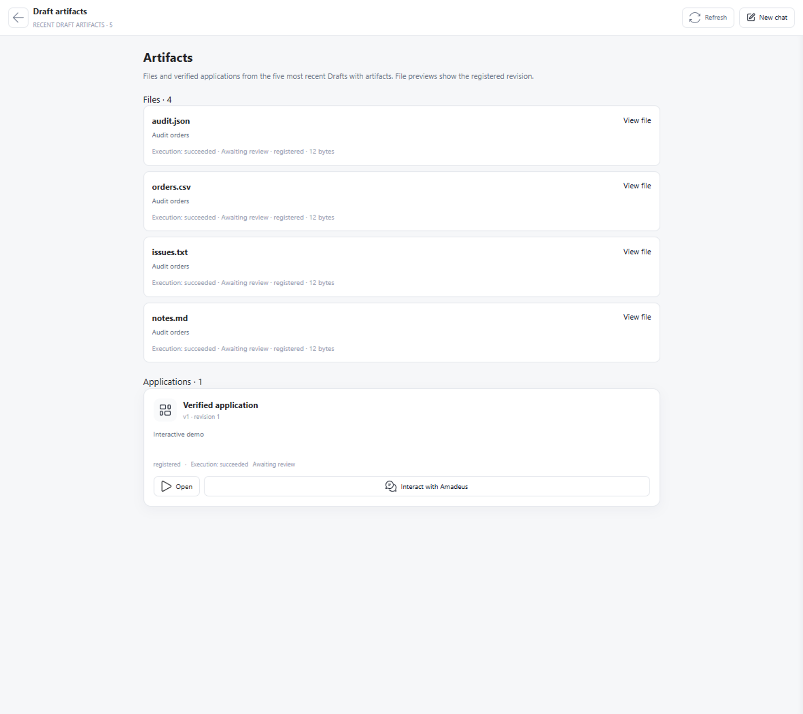
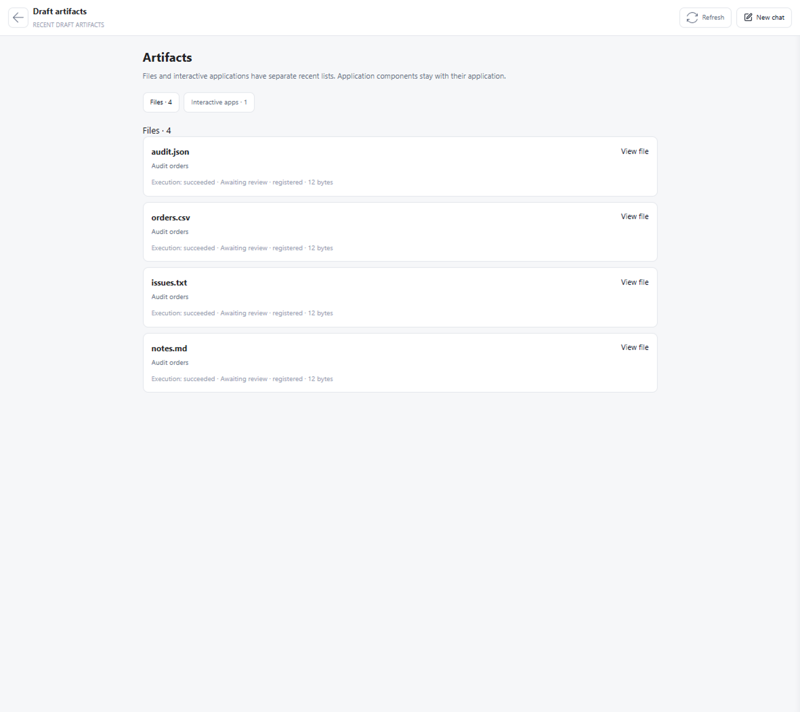
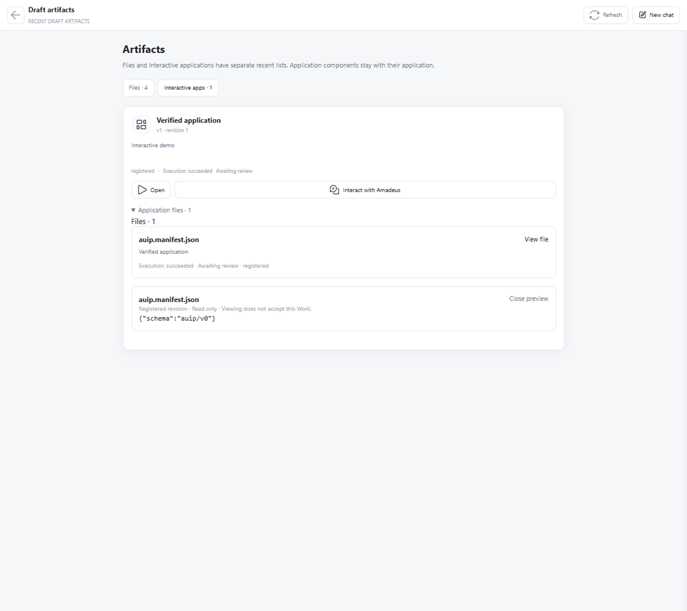
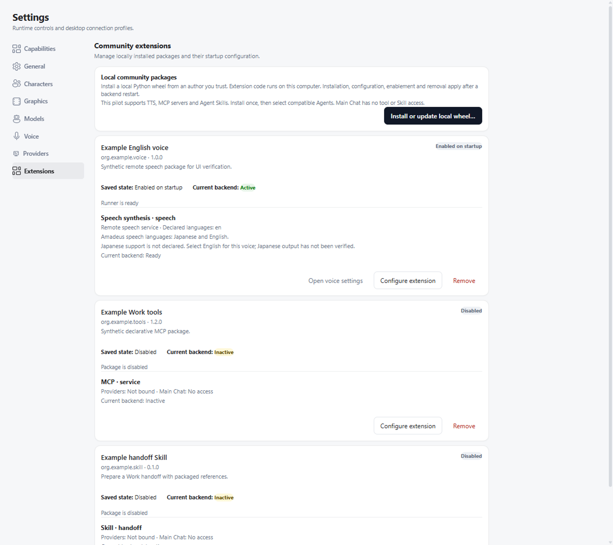

# 插件实验：合并前复查

2026-10-12，`codex/extension-pilot`。已合入 `origin/main` 的 `ad5e409`，
保留桌面开发退出修复及插件停止后清理逻辑。此记录补充
[前轮审查入口](extension_merge_review_2026-10-12.md)，供草稿 PR 审查。
记忆模块没有改动。协议仓只整理已有草案及本轮实现对照，不实现未来记忆接口。
配套协议草稿：[Amadeus-Extensions #1](https://github.com/Code-Amadeus/Amadeus-Extensions/pull/1)。

## 本轮发现并修复

| 问题 | 归属与处理 | 回归证据 |
| --- | --- | --- |
| 初始化钩子抛错后漏掉插件 shutdown | SDK 在调用 initialize 前取得对象的清理责任；shutdown 异常也不会跳过线程池清理 | 真实独立 Python Runner：初始化报错、没有 ready、shutdown 恰好一次 |
| 历史 AUIP receipt 通过路径认领后来的普通文件 | Host 应用发现只认精确 artifact ID；Host runtime 的当前验证仍按其受控资源路径判断 | 同路径新版本先作为普通文件，只有新 receipt 才归入应用 |
| 缺少摘要的入口或 manifest 也可成为应用 | Host 验证必须有已登记且匹配的 SHA-256 | 两种缺摘要情况均无运行卡，原文件仍可见 |
| Provider 声明可能覆盖 Host 文件记录或其最近版本 | 声明使用 Provider identity；`business.*` 声明降为 `provider.artifact` 证据；最近路径视图按 kind 分开 | 字典声明、字符串路径和工具提示均不能改写 registered/pending Host 文件 |
| 自动修复没有继承上一轮产物归属，旧声明路径掩盖了问题 | WorkArtifactRegistry 使用既有、已接受的恢复谱系；只继承直接前驱且摘要仍匹配的文件 | AUIP 和 progress-only 两种恢复；两轮之间的用户改动及无关脏文件均保持歧义；真实 AUIP 启动修复流程通过 |
| 桌面 smoke 仍假设只有 AUIP 空状态 | 更新测试仪器，验证独立文件/应用 tab，并先退出 hover/focus 历史抽屉再点击 | 生产 Electron 的 model-less journey |
| 临时 DSH overlay 被持久化架构门禁误判 | 为准确的函数/写入操作记录例外：TemporaryDirectory 随进程清理、不能恢复持久状态 | maintainability gate 与 overlay 生命周期测试 |

新增回归先观察到失败再修复：首组 4 个失败；声明/恢复组 6 个失败、2 个正确拒绝用例通过。
没有通过放宽摘要、覆盖歧义记录或复用旧 Provider 声明来让测试变绿。

## 生命周期审查边界

- Electron main 是唯一安装事务 owner。先复制并检查 wheel，再准备私有环境；失败保留旧版本。
  安装默认关闭，更新保留兼容配置与绑定；保存仅改变下次启动意图。
- 后端使用固定启动快照；配置更新不热切换。TTS 代理内部有界恢复，不重试已失败的合成请求。
  Runner 环境为白名单；没有 Host Grants 或 Main Chat 工具执行入口。
- Skill 只投影给选定 Agent。Codex/Pi 原生发现检查实际资源；ACP 使用目录或显式 DSH overlay。
  相同 revision 可恢复；更新、禁用、移除、解绑或路径改变后，旧会话在提交前拒绝。
- 卸载和旧代码回收等待后端停止；默认保留数据，显式删除另行选择。重新安装不会恢复旧凭据或启用状态。
- 文件预览读取已登记 ID、核对 Work/当前版本/工作区/摘要并限制大小；不执行 HTML、不接受 Work。
  AUIP Open/Interact 继续经过 manifest、entry、Attach 与会话权限。插件管理不持有产物执行权限。

## ACP 与 Windows ACL 是否阻止合并

| 剩余项 | 本轮实测 | 实验合并判断 | 稳定支持门槛 |
| --- | --- | --- | --- |
| DSH 0.2.0-rc.2 / MCP Client 2.0.0 stdout 污染 | 合成模型触发两个资源目录调用；工具成功，但两行 debug 不是 JSON-RPC；严格 gate 返回 1 | 不阻止默认关闭、明确 experimental 的 TTS/MCP/Skill 实现；问题位于用户另装的 DSH 依赖组合 | 消费上游日志修复并通过 clean-wire gate；当前组合不能标为稳定合规 |
| Windows workspace 缺 WRITE_OWNER | 检出下新建目录初始化失败；临时目录初始化成功，真实受限子进程内部写入成功、外部拒绝 | 不阻止实验合并；这是 DSH shell 沙箱的目录前提，失败保持可见，不降级权限 | 支持文档写清前提，并用实际目标 workspace 验收；不能宣称任意可写目录都支持 |

没有修改用户安装的 DSH/MCP 依赖、屏蔽坏行、自动修复 ACL、迁移用户工作区或降级到 unrestricted。
两项仍属于当前组合的限制，不能被解读为“所有插件全平台已认证”。
上游跟进草稿仍未投稿；本轮只发布本项目的两个授权草稿 PR。

正式合并仍以修复后的必需 CI、维护者/Claude 审查，以及贡献流程要求的设计 Issue 关联为准。
现有 Issue 检索未找到插件设计条目；配套协议 PR 提供设计材料，但不代替维护者的合并决定。

## 验证记录

最终命令、结果和首次失败的修复归属见
[结构化复查证据](evidence/extension_premerge_2026-10-12.json)。
完整隔离运行覆盖 452 个 Python 文件：首轮 5743 passed / 9 skipped / 3 failed，
失败分别是上述两项 AUIP 恢复和一项临时配置写入门禁。修复后的扩展边界回归
190 passed / 1 skipped；SDK/文件/AUIP 定向组 107 passed / 1 skipped。
这不是声称同一个最终快照已重新执行全部 452 个文件；最终提交的全量结果由 PR CI 给出。
Electron 单测 444 passed，production build、Ruff、架构视图检查均通过；
正式 model-less 桌面 smoke 12 项检查全部通过，包括 Electron/后端退出。
真实 wheel 安装/卸载/重装/保留与显式删除数据通过；两类产物及插件管理 UI smoke 通过。
协议仓 61 passed / 1 skipped，两仓 schema 摘要一致。
本轮没有额外付费模型或语音调用；前轮真实模型证据保留其原始范围。

## GUI 管理入口与后续 UI 目标

当前已实现 **设置 → Extensions**，集中安装/更新、配置和凭据、启停、Agent 绑定、
运行状态、卸载与数据保留。Voice 页可以跳回插件管理。它是唯一生命周期编辑入口，
不是要求用户分别去 Voice、MCP、Skill 页面卸载同一个包。

后续建议把同一管理页作为主导航可直达的“插件”入口，设置内保留链接；不要另建一套状态。
列表优先显示当前运行状态、待重启变更和使用它的 Agent/语音用途，详情承载配置及失败原因。
Voice/Agent 页面只选择使用能力并链接所属插件。安装的能力与它生成的文件/AUIP 分属不同界面。
本轮没有临时扩大导航改版；上述入口优化作为独立 UI 目标交由产品审查。

## 可视证据（全部为合成数据）

之前的 `7663549` 组件与其原始 fixture：

当前普通文件视图：

当前 AUIP 及其精确成员详情：

现有统一管理入口：

