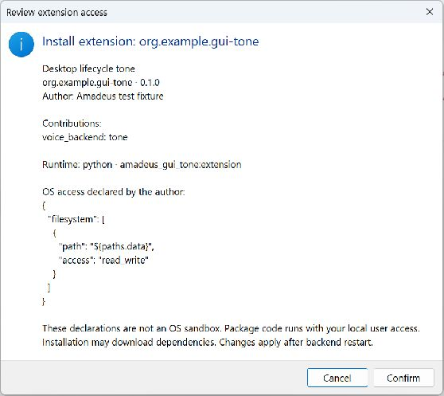
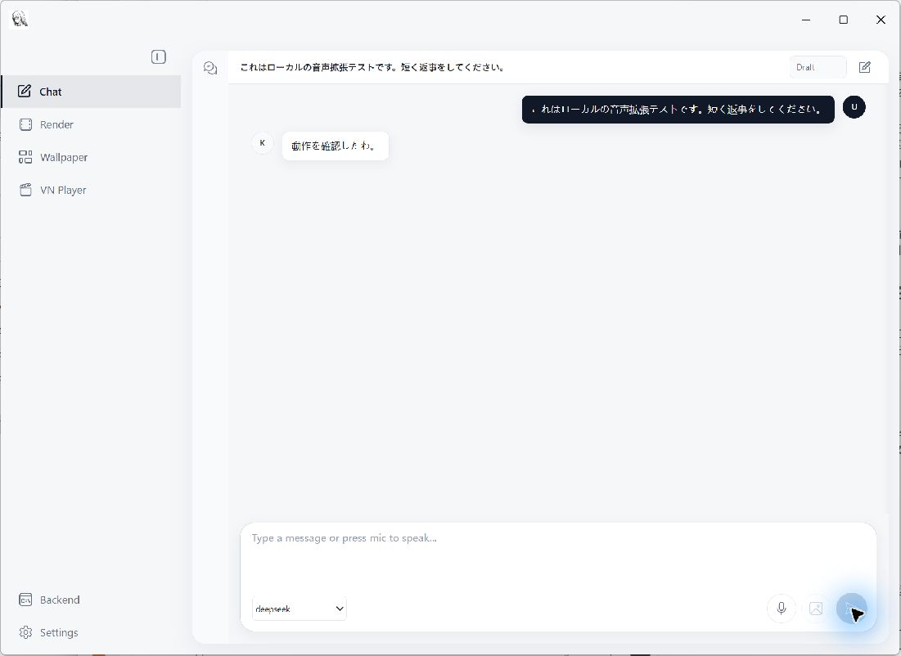
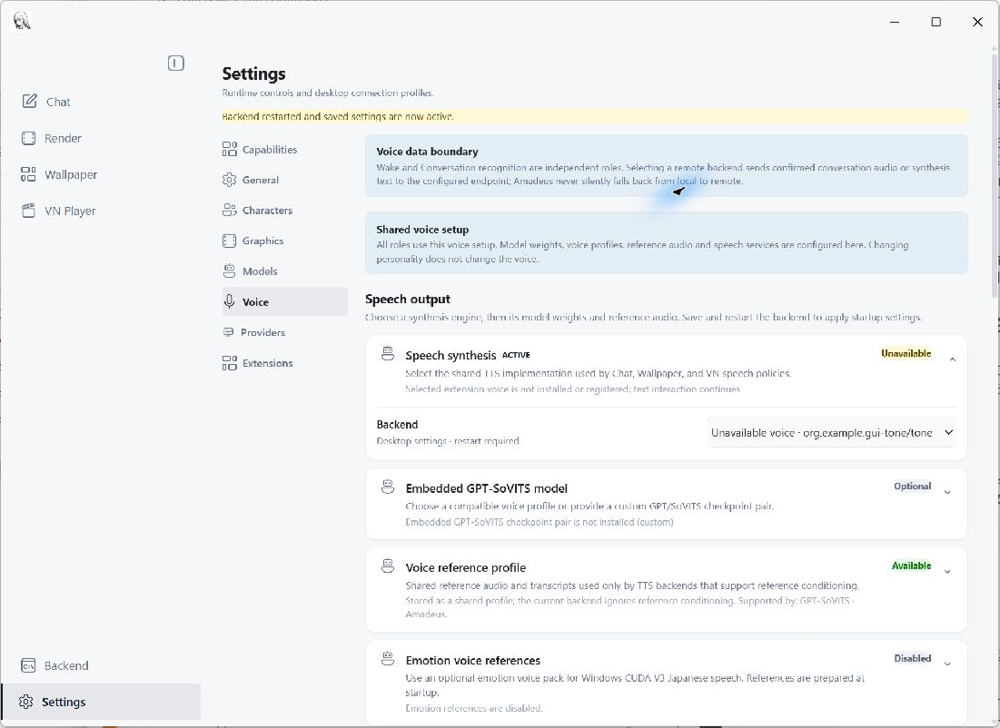
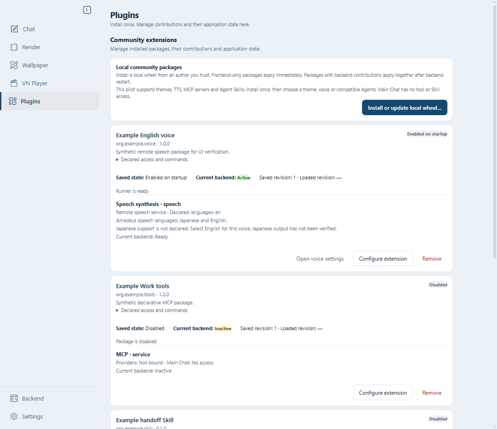
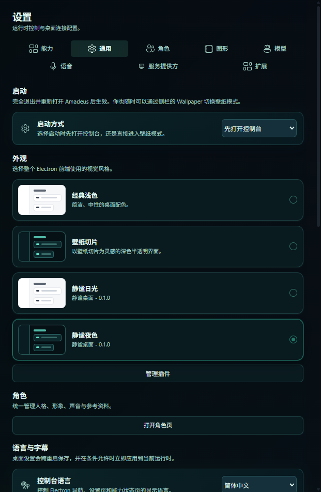
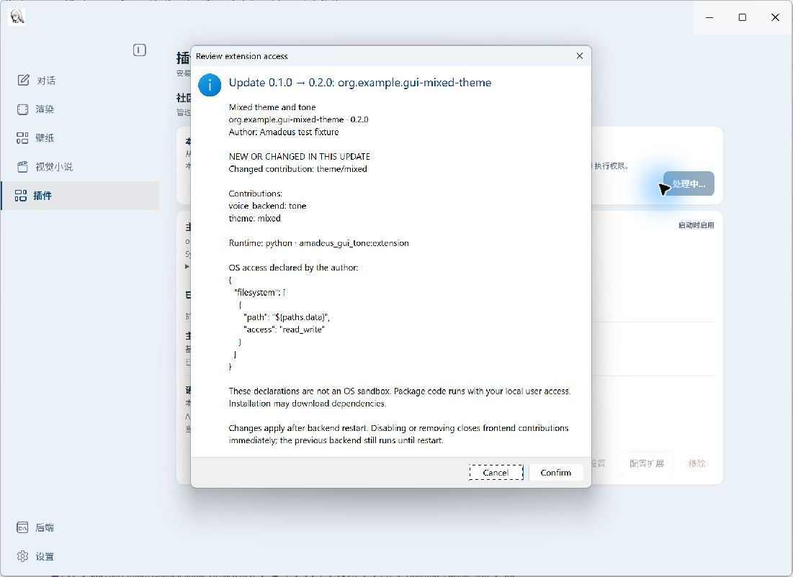
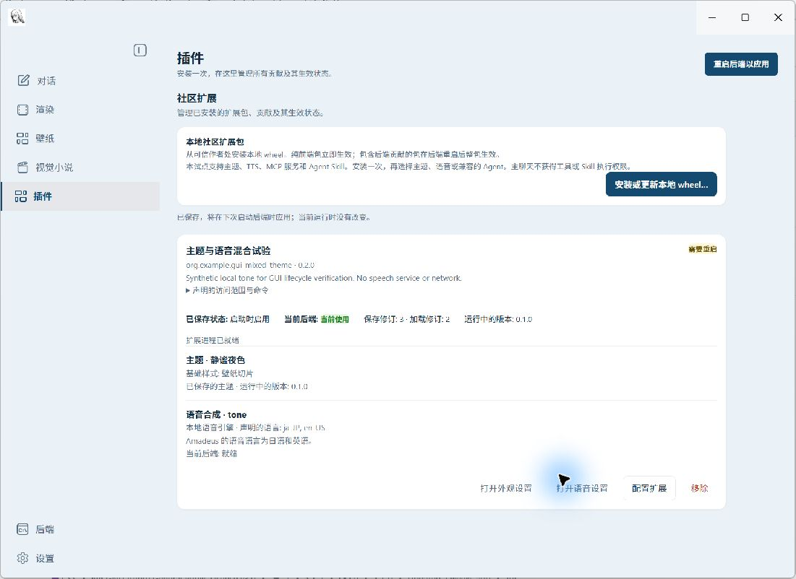
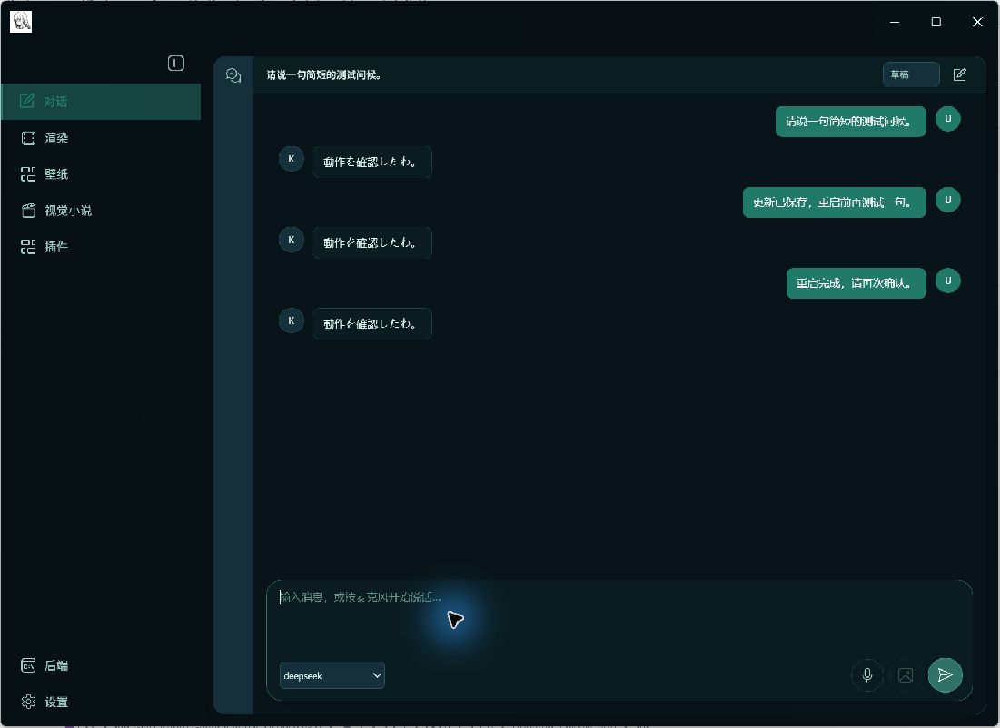
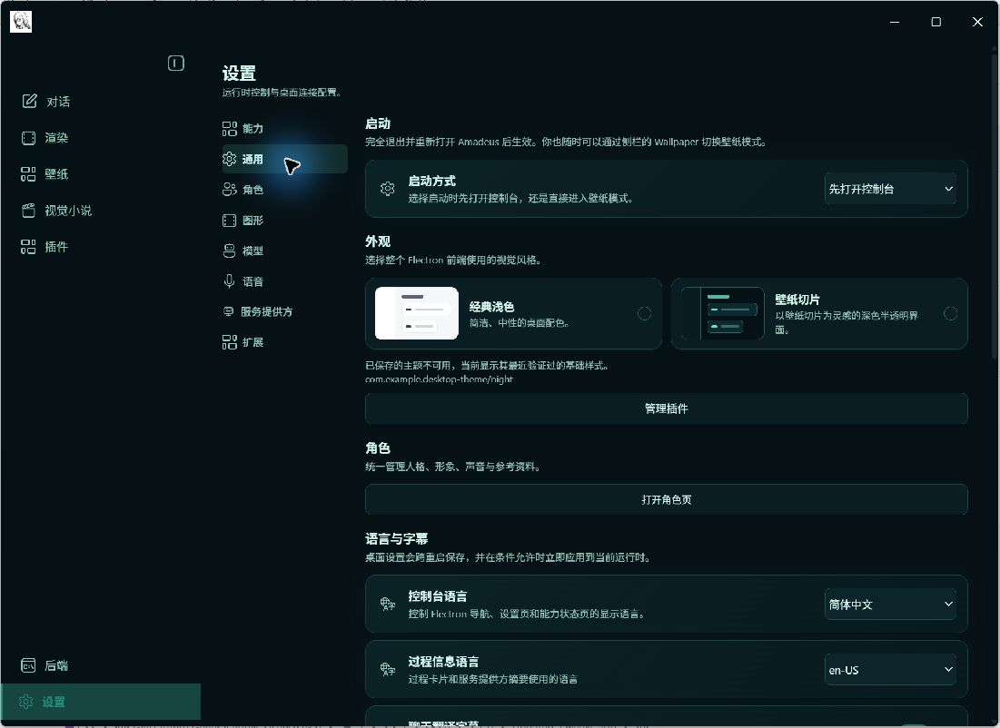

# Extension validation history

These are historical observations at the recorded commits, including withdrawn evidence.
For current authoring use [the author guide](extension_authoring.md) and [Host profile](extension_host_profile_v0.1.md).

## Evidence and explicit limits

Windows local source builds are the tested runtime target. MiMo English live acceptance
is pending; Fish has one live Japanese synthesis, not a listening
or performance certification. Codex/Pi native lifecycle tests use controlled
model endpoints; DSH additionally has real-model and desktop evidence.

The native Windows Electron lifecycle was also exercised in an isolated profile,
with a loopback model endpoint and a local synthetic tone wheel. The production
file picker, install/update/enable disclosures, settings store, Python backend,
independent Runner and playback path were used; no installer or confirmation
handler was mocked. This verifies lifecycle and playback, not paid-model or
natural-speech quality.

| Native GUI journey | Observed outcome |
| --- | --- |
| Install 0.1.0, confirm, enable, select voice, restart | Installed disabled first; activation required confirmation and restart; Chat invoked the Runner with `ja`, neutral `speed=1.0` and 4,800 samples; physical playback started and finished |
| Update to 0.2.0 while active | Saved version became 0.2.0 while 0.1.0 and its installation stayed active until restart; afterwards the old process and directory were gone and only 0.2.0 synthesized |
| Resume Chat after restart | Previous messages reappeared and another reply completed through the new Runner |
| Remove with default data retention, restart | Package, process and installation were removed; data remained; saved voice was visibly unavailable and a new Chat reply remained text-only |
| Reinstall, then remove with explicit data deletion | Reinstalled disabled with the retained data; after confirmed deletion and restart, both installation and saved data were absent |







DSH 0.2.0-rc.2 with MCP client 2.0.0 has a reproduced SDK diagnostic-to-stdout
defect when listing unsupported resources. Keep this combination experimental
until an upstream fix is consumed and the clean-wire probe passes. No Host line
filter or global console monkeypatch is installed. See the
[ACP diagnostics and upstream tracking](acp_provider.md#current-dsh-constraints-and-diagnostics-2026-10-12).

DSH Windows workspace-write confinement requires both DACL and integrity-label
access. A directory can be writable and owned by the user while lacking
`WRITE_OWNER`, causing initialization to fail. The Host does not repair ACLs,
relocate work or downgrade to unrestricted execution. Use the read-only
diagnostic documented in [ACP setup](acp_provider.md).

An extracted source fixture verifies the shipped SDK using Node with an empty
PATH and an unavailable Python override, then installs/imports the wheel offline
in a fresh environment. Damaged bytes fail verification. Runtime Runner and
example tests consume that same wheel, not a second source tree. Build tools
remain development dependencies; frontend builds do not invoke Python.
Public SDK publication, other-platform runtime qualification and natural-voice
Chat/Wallpaper/VN acceptance remain release work. Memory remains out of scope.

## Licensing and SDK delivery (2026-10-13)

Host code remains AGPL-3.0. The canonical protocol/schema/validator and standalone
SDK in Amadeus-Extensions are Apache-2.0. Authored examples carry MIT-0; external
assets, voices, models and dependencies retain their own rights. The current
SDK source pin is retained in protocol main history by the merge of protocol #1.
Theme schema/validator provenance tracks protocol #2 pending its acceptance;
the reviewed SDK wheel and digest are unchanged. There is no PyPI release,
development-directory loader or new diagnostic-log feature in this change.

The installed SDK has PEP 639 license metadata and an embedded LICENSE.
`tools/check_extension_protocol.py --source <protocol-checkout>` verifies the
pinned text copies, wheel digest, metadata/license and packaged SDK source
against the recorded upstream commit. Source releases contain the same wheel.

The canonical build uses CPython 3.12.10 and hash-locked development dependencies.
It normalizes text line endings and ZIP timestamps/permissions, stores entries
without compression and recalculates RECORD hashes and sizes. Protocol CI
compares wheels built independently on Windows and Linux. The Host carries that
artifact unchanged; runtime still requires Python >=3.11. Matching SDK build
bytes do not imply cross-platform qualification of the Host or third-party
extensions.


### Explicit backend startup receipts (2026-10-13 audit follow-up)

The paired Electron/Python Host reports a received revision and a separate
`startup: accepted|rejected` result. A unique valid identity/revision rejected
by Python validation settles that launch without creating a loaded receipt.
A missing required configuration also rejects startup. Dynamic Runner health
and per-contribution availability do not rewrite a successfully accepted
snapshot. These receipts describe Host snapshot admission, not voice readiness.

HTTP/JSON/status-section failures, an unreadable whole startup snapshot,
duplicate identities, missing/invalid results and mismatched revisions are
unconfirmed. They never count as rejection or success, never confer loaded
state, and retain pending work with a diagnostic. Host preflight failures remain
known rejections. Revision comparisons still prevent late replies from clearing
newer edits. No package filesystem or Runner authority is granted by a failure
receipt, and SDK bytes/wire contracts are unchanged.
## Local theme pilot acceptance (2026-10-12)

The local branch integrates extension lifecycle 55551e1 and Work files/AUIP
adf1632 without changing either parent PR. P1 support/profile and persistence
rules are committed separately from P2 theme/UI work. The companion schema
source is pinned to 9c3f3a5 on a local protocol branch; publish that source
before opening a downstream PR that references it.

Automated evidence includes 470 desktop unit tests; 130 Python extension,
SDK, files/AUIP regressions (2 skips); the official model-less Electron smoke;
and the production-component visual smoke in English/classic at 1100 px and
Chinese/wallpaper-slice at 620 px. These visual fixtures use synthetic Host
snapshots, actual React components and the actual theme validator/renderer.
They verify base identity, one installed style, Blob image visibility, absence
of covering builtin gradients and no horizontal overflow. They do not exercise
native installation confirmation.

The following component-fixture screenshots were refreshed after the 2026-10-13
audit repairs, including the synthetic loaded revision. They are not new native
dialog acceptance evidence.





A separate local diagnostic used the real Electron installer/store, trusted Python
wheel helper, native image/font APIs and an independent SDK Runner. Confirmation
decisions were supplied by the driver; it did not operate native dialogs.
The pure-theme lifecycle retained backend PID 11912, including cancel, invalid
update rejection, disable/re-enable, retained-data reinstall and explicit deletion.
The mixed journey used backend PIDs 12788 then 2272 and Runner PIDs 4296 then
34160. Completed tone requests were v1, v1 (after v2 was saved), then v2 (after
restart), each 4,800 samples at 24 kHz. Old installation references survived until
shutdown; final removal deleted the requested data. This is process/contract
evidence, not Chat playback or native GUI acceptance.

The process journey is reproducible on Windows after the normal desktop build:

```powershell
python tools/probes/extension_theme_lifecycle.py
```

The probe builds all synthetic wheels offline, creates a fresh profile, and
records the report under `build/extension-theme-lifecycle/<run>/report.json`.
It verifies real image decoding and installed fonts, pure-theme preparation
without pip/venv, actual revision acknowledgements, two mixed-package versions,
SDK audio and removal. Its isolated Python process hosts `ExtensionRuntime`;
it is not the HTTP/WebSocket server or the Chat playback path. Confirmation
choices are supplied by the driver and reported explicitly.

The P2 native Windows GUI journey also passed in an isolated profile. The real
file picker and native install/update/enable dialogs were operated, followed by
production settings, the backend, independent Runner and Chat playback. A local
synthetic model and tone package keep this repeatable without paid services.

| Native theme journey | Observed outcome |
| --- | --- |
| Pure theme install, enable and select day/night | Installed disabled first; both palettes applied immediately without backend restart |
| Cancel v2 update, then accept it | Cancellation preserved v1, its revision and installation; acceptance applied v2 and reclaimed the old resources |
| Invalid v3 theme | Contrast validation rejected the update and preserved working v2 |
| Disable/re-enable, remove, reinstall and delete data | Immediate fallback preserved the saved theme identity; re-enable restored it; retained data survived a disabled reinstall; explicit deletion removed it |
| Mixed theme/TTS v1, then save v2 | Saved revision 3/version 0.2.0 while loaded revision 2/version 0.1.0 remained active; Chat still invoked the same v1 Runner |
| Disable, then re-enable before restart | Frontend access closed immediately and stayed closed; the UI disclosed that the old backend continued until restart |
| Restart mixed package and resume Chat | Revision 5/version 0.2.0 applied together; old process and installation disappeared; history resumed and the new Runner played a response |
| Remove mixed package with data deletion, restart | Record, installation, data and Runner disappeared; theme/voice selections retained their unavailable identities; another Chat turn completed without speech |

The pure-theme journey kept the same backend process throughout. The mixed
journey completed three Japanese-tagged requests in order: v1, v1 after v2 was
saved, and v2 after restart. Each produced 4,800 samples at 24 kHz; playback logs
recorded physical start and completion. The final text-only turn added no
playback. These are observed process and playback results, not a subjective
listening assessment of natural speech.

Acceptance found two stale-feedback cases: a rejected update left an earlier
success notice, and a successful restart left the old pending-start notice.
Operation feedback now clears at the next attempt and confirms only that saving
succeeded; package cards remain the source of current application state. Both
cases have component regressions. The final build and visual smoke passed after
this presentation fix; the full native journey above preceded that final fix.









No remote paid synthesis, natural voice audition or cross-platform GUI
certification is claimed. Narrow-window evidence is from the production-component
Electron smoke, not the native-dialog journey. DSH/ACL constraints described
above are unchanged; this theme work does not qualify a new Agent path.

## Audit repair revalidation (2026-10-13)

The parent file-delivery branch now preserves amendment ownership through
recovery and keeps previews stable during unrelated renderer updates. The
extension branch builds with the documented core-only Python environment and
recovers overdue cancellation under the existing bounded budget. General MCP
environment migration and desktop process shutdown are separate reviewed
dependencies; this pilot consumes their contracts.

After synchronizing those changes, the P1-only head passed 464 Electron tests
and the normal build. The combined P1/P2 head passed 478 Electron tests and
211 scoped Python regressions (2 skips), plus the core-environment build. The
actual model-less Electron smoke passed all 13 checks, including Plugins,
file/app separation and clean shutdown. The reusable theme lifecycle probe also
passed with the real installer/store and SDK Runner; its confirmation choices
are supplied by the driver, not native dialog input.

The earlier native-dialog and physical-playback acceptance remains historical
evidence for its recorded head. No second full manual GUI run, natural-voice
audition or new Agent/cross-platform qualification is claimed for this repair.
The new cancellation and shutdown failure regressions address gaps that the
earlier normal lifecycle journey did not cover.

## Mainline reconstruction and focused revalidation (2026-10-13)

P1 is rebuilt from its own reviewed diff on main `c569a0f`, which contains
the accepted file/AUIP, MCP migration, backend shutdown and extension lifecycle
PRs. Its stable patch-id is unchanged. P2 is rebuilt on that P1, preserving
the accepted SDK source `49449a0` and wheel digest. Theme schema/validator
provenance now points at protocol #2 `223aac5`; that theme contract remains
provisional pending separate review and merge. Developer mode, logs and memory
are outside this reconstruction.

The prior Electron Windows failure was reproduced in the real offline settings
smoke: its standalone test entry did not register `desktop-theme.get`, so the
theme provider could not obtain the locked theme and the GUI assertion timed
out. The smoke now calls the production `ExtensionInstaller.themeState` owner
through that IPC handler. Its eight existing outcome checks pass without a
backend or Python process. No production fallback or timeout increase was added.

Fresh local evidence on the rebuilt implementation:

- P1: 99 Python tests passed, one symlink privilege skip; 467 Electron tests
  passed and the production build passed with an unavailable Python override.
- P2: 264 scoped Python tests passed, three skips (two Windows symlink privileges
  and the optional DSH runtime); all 481 Electron tests passed. The scoped suite
  includes ordinary-file/AUIP ownership, preview and launch boundaries.
- The actual Electron/backend model-less smoke passed all 13 checks, including
  Plugins navigation, saved startup mode, separate file/app views and clean
  process shutdown.
- The production-component smoke passed its seven journeys, including theme
  rendering at 1100px English and 620px Chinese and the 560px configuration form.
  Host responses in this visual fixture are synthetic; image/font validation
  and component rendering use the real implementation.
- The real installer/store, native image/font validation and independent SDK
  Runner lifecycle probe passed. Pure themes retained their backend process
  with no venv or pip; mixed synthesis used v1, v1 after saving v2, then v2 after
  restart. Cancellation/rejected updates retained the working version, frontend
  admission closed on disable/remove, and owned processes/resources/data were
  cleaned according to the selected retention policy.

The lifecycle probe reports `nativeDialogs: false`: confirmation decisions were
supplied by the driver. The 2026-10-12 manual native-dialog/Chat playback journey
above remains historical evidence; it was not repeated or relabeled as a new
manual acceptance run. Final-head CI and focused external review remain the
merge gates for P1/P2 and protocol #2.

## First audit repairs (historical, 2026-10-13)

**Evidence correction:** the historical 14-check model-less smoke claim below is
withdrawn. Its asynchronous predicate could return false without failing the
wait; see the second audit investigation and replacement acceptance below.

P1 now retires logical backend receipts at every new launch, independently of
whether prior process-tree cleanup was confirmed. File deletion still requires
the original confirmation/reference boundary. POSIX resource extraction keeps
executable bits only (never setuid/setgid); its regression actually runs the
bundled command on Linux/macOS. A Host-generated `startup_error` settles that
launch revision without pretending it loaded; later edits remain pending.
Frontend-only validation/removal errors do not create backend restart work.

That first repair pinned protocol #2 `d06f319`: its published 25-token allowlist and literal/image
signature checks are shared by the Host. Runtime font availability, full native
image decoding and palette contrast remain Host responsibilities. The stricter
readability rules and theme-independent recovery described above replace the
previous fixed-white accent labels and translucent surface allowance. Plugins
now opens Voice in the navigable Settings view and preserves its remembered
section. Theme notifications no longer expose raw Electron events; startup
chrome uses the last verified theme base. Screenshot fixtures carry real-shaped
loaded revisions and the current component screenshots were refreshed.

Other checks from that first repair: 492 Electron tests, production build, eight
offline startup GUI checks and eight component visual journeys passed. The
separate 14-check model-less report is withdrawn as recovery evidence; see
the investigation below. The real
installer/store/native image/font/SDK Runner lifecycle probe passed for both
resource-only and mixed packages; it reports `nativeDialogs: false`. It is not
a new manual confirmation or natural-voice playback run. Protocol tests passed
91 cases with one local Windows symlink-privilege skip. SDK bytes remain unchanged.

Known lifecycle limit: once the old backend has stopped and references are
released, a mixed-package update may collect v1 before v2 finishes starting.
Preparation failures preserve the old version, but a later startup failure does
not provide automatic rollback. That behavior is disclosed, not expanded in
this repair. Linux/macOS executable-bit execution is a required CI check rather
than a claim of local Windows execution. These PRs remain Draft pending final
head CI and focused external review; no merge, developer mode, logs or memory
work is included.

The final scoped Host Python run passed 264 tests with four skips (POSIX execute
bits on Windows, two symlink privilege checks, and optional DSH availability).
Canonical-source comparison passed. Clean release gates passed for P1 (3,991
selected / 101 excluded) and P2 (4,021 / 95), each with zero errors or warnings.
Protocol #2 final-head CI also passed Windows/Linux contracts and wheel byte
comparison; downstream Host final-head checks remain separate merge gates.


## Second audit: rendered surfaces and receipt evidence (2026-10-13)

This audit pinned protocol #2 to `d5c8a7d` (superseded by the merge follow-up below). Theme v0 supports PNG/JPEG only, including
matching signatures and actual native decoding. WebP declarations fail before
installation, and renaming WebP bytes does not grant acceptance. The canonical
night example and shared valid/invalid CSS literal cases are pinned as fixtures;
Host tests validate that example and real Chromium accepts the supported syntax.
Comma and space/slash forms cannot be mixed. Host-specific validator help and
provenance match again; the SDK wheel is unchanged.

Hard-coded wallpaper-slice card/tab decorations now apply only to the builtin
base. Extension capability cards and nested visual controls paint the same
opaque token surfaces used by the Host proof. A native Electron regression
checks decoded PNG/JPEG files and actual Chromium computed styles/contrast for
an accepted near-threshold black palette and an image-backed translucent canvas.
It also verifies builtin decoration returns after leaving the extension theme.

Mixed-package selection resolves content from the applied manifest while the
current desired record retains enable/removal authority. A saved v2 that drops
or renames a selected v1 theme therefore leaves v1 visible until restart.
New themes wait for v2 admission; disable/remove still closes frontend access.

### Why the earlier 14/14 result was invalid

A clean rebuild of `d7988dc` produced the same renderer asset names as the old
build log. Running its real application in a new profile returned
`AMADEUS_UI_THEME is locked by the parent process environment` for the theme
setup. The probe stopped before invoking the native error dialog. An independent
Chromium reproduction with Playwright 1.60.0 showed that
`wait_for_function("async () => false")` immediately returned a handle to false,
while a synchronous false predicate timed out. This known Promise-truthiness
behavior is recorded in [Playwright #29132](https://github.com/microsoft/playwright/issues/29132).
The checked release tag is `87bb9ddbd78f329df18c2b24847bc9409240cd07`;
this was reproduced without modifying Playwright. No duplicate upstream issue
was opened.

The smoke made two errors: it ignored a failed setting-save reply and used an
asynchronous wait predicate as proof of persistence. The resulting true check
flag did not establish recovery, so the prior local and CI green results are
not accepted as recovery evidence. This was a test-instrument defect, not a
reason to relax the product's environment lock.

The corrected smoke removes the inherited theme variable, checks each IPC save
reply, verifies classic -> wallpaper-slice -> shortcut -> classic, and awaits
saved values in Python with explicit comparisons and a deadline. The existing
startup-mode persistence check uses the same corrected polling. DOM theme changes
use locator attribute assertions, avoiding wait-for-function eval under the
shipping CSP. The GUI launcher uses an explicit environment allowlist, a temporary
profile and a checkout without `.env`. A temporary loopback main inspector
checks the owned PID and sole main-window identity, then uses Electron
`sendInputEvent` to exercise the actual `before-input-event` hook. The probe
does not call recovery directly; its connection closes immediately and the
inspector exits with the owned test process. Production startup and CSP remain
unchanged. Regressions prove a missing/wrong saved value times out. Fresh reports bind source identity
and the actual dist/packaged-ASAR digest to the result. The accompanying PR lists
the final clean-build GUI runs; historical reports above remain distinguishable.

Installation dialog decisions in the separate lifecycle probe remain driver
supplied. Mixed-package startup failure still does not guarantee rollback after
old references are released. No developer mode, logs feature, memory or later
phase was added by that repair; all three PRs were kept Draft for external review.


## Merge follow-up (2026-10-13)

Host P1 (#191) was merged as `2799ba8`. Protocol #2 was merged using merge
commit `bf1a848`, retaining the pinned source `b30df73` in protocol main history.
P2 was moved onto Host main without changing its file tree; its final head is
subject to fresh CI before the authorized merge. Protocol source is now pinned
to `b30df73`. Both the main specification's P4
check and the theme contract consistently restrict v0 images to PNG/JPEG; the
WebP exclusion no longer interrupts the background-field description. Protocol
runtime/validator/SDK bytes are unchanged by this documentation correction.

If a selected theme is absent from the loaded package, the Host recommends a
restart only when a different saved revision contains that theme and the
package requires restart. A theme removed by a frontend-only update or absent
after backend restart instead directs the user to choose another theme in
Appearance, preserving the saved identity and last verified base. Regressions
cover both actionable pending additions and removed frontend/mixed themes.
