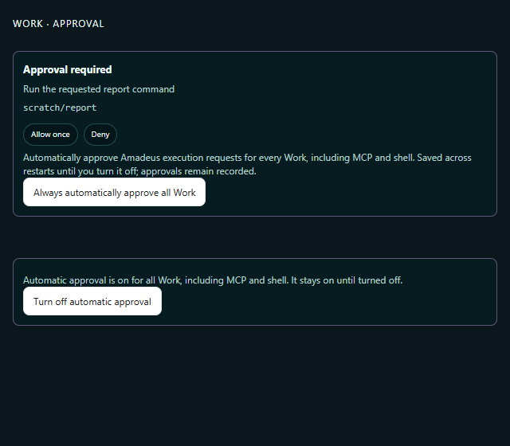
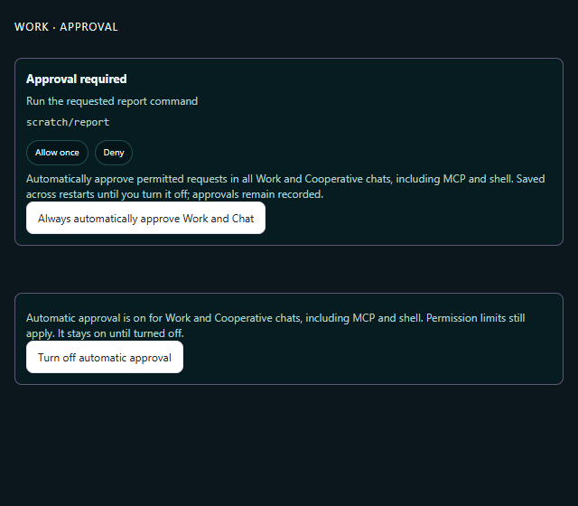
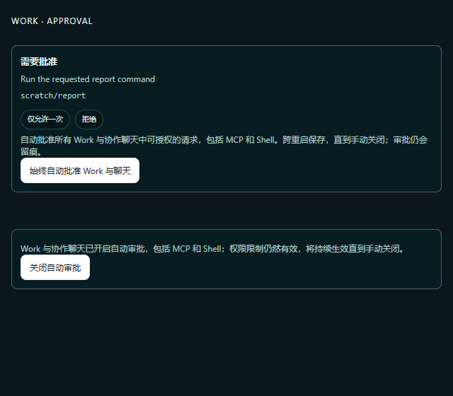
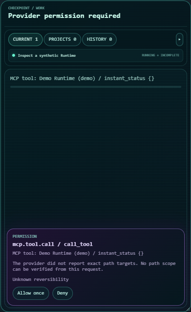
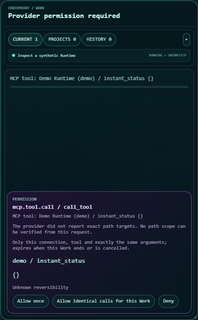
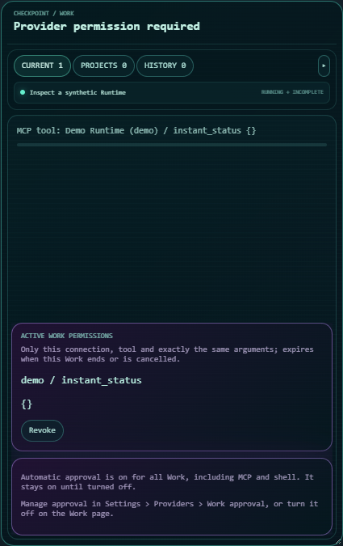

# Work approval choices

## Permission-boundary repair — 2026-10-20

The maintainer follow-up starts from reviewed head
`9f58b5e5ec5d4213826713e533e1484c570a0d31` and merges main
`02f485ab7ea4119beac19241831356912d709287`, including the Pi model-metadata
change and #237. The original head's hosted results below are historical; they do not
establish the follow-up's CI status.

Cooperative request options, manual approval and automatic authorization now
share the owner's permission-eligibility predicate. With automatic approval
either off or on, `deny` remains denied and read-only contexts reject Shell,
file-write and generic tool execution. `ask` still permits external MCP calls
in read-only contexts and Shell in writable contexts. Tests also cover pending
options created before owner limits change, hot enabling, and eligible
background chats.

Runtime dispatches an already committed policy decision even if the setting
changes while an asynchronous owner returns; subsequent requests wait after
the setting is disabled. The redundant startup authorizer registration is
removed. UI and documentation explicitly include Work and Cooperative chat;
enabling the persisted global setting from a permission card asks for
confirmation, and cancelling leaves the setting unchanged. The configuration
key and default remain unchanged.

Validation on Windows x64, CPython 3.12.10 and Node 22.21.1:

- **73 passed** in the five permission modules listed below, including the new
  boundary matrix and real SQLite commit/dispatch regression.
- The nine integration modules below initially produced **168 passed / 1
  failed**, with no skips. The failure was a Canvas assertion expecting the old
  settings-group title. After updating that assertion, the entire Canvas module
  produced **2 passed**. The eight real pinned Pi scoped-approval subprocess
  tests passed in the integration run; they use synthetic loopback model/MCP
  services, not external model calls.
- Full Electron tests initially produced **530 passed / 1 failed** because
  newly added translation keys were unsorted. After restoring the catalog's
  required ordering, **531 passed**. `npm run build` passed, including config,
  extension SDK and Pi TypeScript checks.
- Changed Python files passed Ruff; `git diff --check` passed.
- An initial permission-test invocation had a missing parent for the chosen
  temporary directory (14 passed / 59 setup errors). Creating the parent
  resolved this test-runner setup issue; it is not counted as a product failure.
- Main advanced from `79ef387a` to `02f485ab` during the repair. Its added
  generated `.env.example` groups conflicted with the approval group; all groups
  were retained and the catalog outputs regenerated. After this integration,
  **145 passed** across permission, system-settings, environment and Canvas
  modules; **535 Electron tests passed** and the production build passed again.
  The previously tested permission implementation and Pi runtime were unchanged
  by this second merge.

Commands from the repository root (Python uses the installed development
environment; temporary directories and bytecode/cache options are omitted):

```text
python -m pytest -q tests/test_cooperative_automatic_permissions.py tests/test_cooperative_scoped_permissions.py tests/test_automatic_permission_owners.py tests/test_automatic_permission_persistence.py tests/test_provider_automatic_permissions.py
python -m pytest -q tests/test_pi_scoped_approvals.py tests/test_pi_provider.py tests/test_pi_model_metadata.py tests/test_work_scoped_permissions.py tests/test_work_permission_service.py tests/test_work_activity_permissions.py tests/test_canvas_work_preview_renderer.py tests/test_chat_ingress_lifecycle.py tests/test_cooperative_context_recovery.py
python -m pytest -q tests/test_canvas_work_preview_renderer.py
python -m pytest -q tests/test_cooperative_automatic_permissions.py tests/test_cooperative_scoped_permissions.py tests/test_automatic_permission_owners.py tests/test_automatic_permission_persistence.py tests/test_provider_automatic_permissions.py tests/test_system_settings.py tests/test_environment_config.py tests/test_canvas_work_preview_renderer.py
npm --prefix electron test
npm --prefix electron run build
```

The screenshots render the actual `WorkPermissionsPanel` with production CSS
and synthetic permission data in an isolated headless browser. The before
component comes from `9f58b5e5`; the after components use this repair. Both the
pending card and enabled-policy notice are shown. English and Chinese renders
were visually checked and have no horizontal overflow. Confirmation behaviour
is covered by the component test (cancel then accept); the native dialog is not
depicted in these screenshots.

| Before | After | After, Chinese |
| --- | --- | --- |
|  |  |  |

中文：本轮修复了自动审批绕过 deny／只读限制的问题，保留合法 MCP、可写 Shell 和后台
聊天自动审批；开关文案明确覆盖 Work 与协作聊天，从审批卡开启时增加确认。权限专项
73 项通过，真实 Pi 子进程通过；合入后来更新的 main 后，权限与配置等 145 项、Electron
535 项及生产构建再次通过。首次测试中的临时目录、
翻译排序和旧标题断言问题分别记录；下文原提交的 CI 记录不代替本轮 CI。

Related issue: [#224](https://github.com/Code-Amadeus/Amadeus/issues/224).

This change adds two explicit choices while keeping automatic approval off by
default: a persistent all-Work execution policy, and a revocable exact-call Pi
MCP grant confined to the active Provider run. Desktop settings own persistence;
Provider Runtime owns policy application and audit, and Pi owns its native
callback translation. Restoring a native session never restores a grant.

## Windows concurrency-test follow-up / Windows 并发测试复查 (2026-10-18)

The hosted Windows shard for `f9d4a0c` failed one case in
`test_cooperative_independent_auip_work.py` (44 passed / 1 failed), so its
aggregate gate also failed. Other Windows shards and the smoke job passed.
The [original failed job](https://github.com/Code-Amadeus/Amadeus/actions/runs/39081969148/job/117540598847)
is retained; this is distinct from the earlier VTS test-double failure below.

The app had already entered its synthetic pending operation. The timeout was
the next two-second wait for the Work adapter to start. That wait also included
real Host intake, scratch Git initialization and Git baseline collection, up
to seven external Git processes unrelated to this test's independence contract.
The CI trace does not identify which individual process was slow. The original
case and all 45 module cases passed on local replay; on the supported CPython
3.12.10 baseline, adding a controlled 2.25-second delay only to Git initialization
reproduced the same wait failure while the product still dispatched both domains
concurrently.

The repair is confined to this test. It uses a real private scratch directory,
real SQLite/dispatch and the existing filesystem baseline implementation, while
excluding Git subprocess startup. The stored baseline source is asserted as
`filesystem`. The app is explicitly asserted to remain blocked both when Work
starts and when later Chat completes. All original assertions and the two-second
hang guard remain; production scheduling and permission code are unchanged.
The separate scratch-destination and artifact-registry suites retain real Git.

Fresh checks on CPython 3.12.10:

- The controlled slow-Git probe failed before the repair and passed after it.
- A negative control deliberately serializing Work behind the blocked app still
  failed at the same event wait after the repair, demonstrating the test still
  detects an independence violation.
- The target passed in five fresh consecutive pytest processes.
- The full affected module plus scratch-destination and artifact-registry
  suites passed **75 tests**, with zero failures/skips; these overlapping checks
  are not added to the earlier 148-test or 44-test selections.
- Narrow Ruff, diff and UTF-8 checks passed. No external model request or real
  desktop operation was used.

Final hosted status is reported on PR #234's checks and description; local
results do not substitute for the new head's hosted checks.

中文：本次是 `f9d4a0c` 的独立应用／Work 并发测试等待超时，原模块 44 过／1 失败，
汇总门禁随之失败，与此前 VTS 替身遗漏分开记录。应用分支已进入，Work 启动前仍有
真实 Git 初始化和基线采集；CI 未记录具体哪条 Git 命令慢。本地原模块能通过，另在
3.12.10 上仅注入 2.25 秒 Git 延迟，复现了相同超时机制。

修复只隔离该测试无关的 Git 进程，保留真实临时目录、台账、派发和持久化 filesystem
基线；原断言和两秒上限未放宽。正控恢复通过，故意让应用阻塞 Work 的反控仍失败，
目标连续五个独立进程通过，相关三模块合计 **75 项通过**。生产代码和权限门禁未改；
真实 Git 仍由专属测试覆盖。首次远端失败、受控复现、本地复跑和新 head 远端状态分别记录。

## Hosted follow-up / 远端复查 (2026-10-18)

Hosted checks for `a5d699e` finished with 14 successes and two failures. The
Windows `python-suites (0)` job had exactly one failing suite:
`test_vts_worker_lifecycle.py` (13 passed / 2 failed). Both cases executed the
actual application cleanup against a Runtime test double missing the newly
required `set_automatic_permission_authorizer` hook. The aggregate
`cpu-model-less` gate consequently failed; its smoke prerequisite succeeded.
The [original failed job](https://github.com/Code-Amadeus/Amadeus/actions/runs/39020511237/job/117361196306)
is retained separately from subsequent checks.

The same 13 passed / 2 failed result was reproduced locally before the fixture
was corrected. Adding the missing mock hook keeps the real cleanup path under
test and changes no production code. The VTS worker and Chat ingress lifecycle
modules then passed **44 tests**; narrow Ruff and diff checks also passed.
New-head hosted CI must be assessed independently of this successful local rerun.

中文：远端两项失败实际来自同一个测试接口遗漏，汇总门禁随之失败。先在本地复现
VTS 模块 13 过 / 2 失败，再补齐测试替身的新接口；VTS 与 Chat 生命周期合计
44 项通过。生产代码未改，原远端失败保留，新提交 CI 与本地复跑分开记录。

## Review follow-up / 审核修复 (2026-10-17)

The review reproduced an authority-boundary defect on `7bd966f`: an ordinary
SQLite permission-request write failure was swallowed by the event bus, after
which Runtime still sent one automatic allow response with zero permission
records. The new regression selection initially produced 2 passed / 4 failed,
covering request writes, decision writes, hot enable and an unknown response.

Runtime now requires a trusted Work or Cooperative permission owner to locate
the exact committed pending request and commit `policy_allowed` before native
response dispatch. No owner, a failed commit or a cancelled checkpoint cannot
approve the call. The attempt is reserved before awaiting the owner, so an
unknown or interrupted response is never resent. This durable decision records
Host authorization intent; it is not a receipt that the Provider executed the
operation. Conflicting content cannot reuse an existing pending request ID.
Settled request identities remain fenced until their run ends, even when an
expiry write fails. The two expiry/replay probes first failed, then passed
after retaining that fence. Their expiry fixture was then corrected to include
the native automatic-expiry flag and assert the observed persistence error;
both corrected probes pass. Presentation subscribers remain ordinary event-bus
observers.

Fresh local checks of this follow-up:

- Permission owners, real SQLite persistence faults, Runtime, Work permission
  service/scopes, Cooperative scopes/contracts and EventBus: **80 passed**.
- Chat shutdown, Work handler and Provider abstraction: **60 passed** after
  extending the shutdown test double with the new Runtime hook. The initial
  run had 54 passed / 6 failed because that test double lacked the setter;
  those first failures remain distinct from the successful rerun.
- Real pinned Pi subprocess scopes: **8 passed**, including two newly started
  automatically approved Work runs with committed decisions and a third run
  waiting for user approval after the persistent policy is disabled.
- Repository Ruff, all seven generated architecture views, generated README
  overview and `git diff --check` passed. No UI source changed in this follow-up;
  the earlier Electron/render evidence below belongs to its recorded candidate.

中文：本轮先复现“权限请求落库失败但仍自动允许”，再在真实持久化拥有者修复。
请求记录和策略决定均成功提交后才派发；失败、取消或缺少拥有者时拒绝自动授权。
决定是授权意图，不能当作执行成功回执；未知结果不重发，相同请求身份不得换参数。
结算写入失败也不会释放旧请求身份供重放。三组选定回归共 **148 项通过**；首次失败
与修复后复跑分别保留。只使用临时 SQLite、
本地合成模型/MCP 和真实 Pi 子进程，未调用外部模型或替换日常安装版。

## Deterministic checks

- Real Pi 1.2.0 subprocesses, a loopback synthetic model and local MCP peers:
  repeated calls, changed arguments/tools/connections, revocation, cancellation,
  native session restoration and connection changes.
- Host contracts: request publication before automatic response, immediate
  grant-use/expiry audit, immutable user decisions, unknown responses not
  resent, concurrent Work isolation, hot enable/disable and partial failures.
- Presentation contracts: ordinary Work/Cooperative approval and revocation,
  multiple grants, foreground ownership, background expiry, persistent settings
  reopening and accurate feedback after partial application.
- Electron `npm test`: 529 passed. `npm run build` and Pi typecheck passed.
- Final approval/Provider/Work/Cooperative/Canvas/wallpaper regression selection:
  77 passed, including real Pi calls across two automatically approved Work runs
  followed by a third run that waits for approval after the switch is disabled.
- The complete isolated Python suite ran in four shards on the documented
  CPython 3.12.10 baseline: 5,934 passed, 34 skipped and 4 failed initially.
  The new scrollbar declaration violated the existing shared-surface contract;
  it was removed, and the wallpaper/Canvas checks then passed (16 checks).
  An unchanged texture-cache HTTP test hit a Windows connection-aborted error;
  its complete module passed on rerun (25 checks).
- Two unchanged optional Codex Skill tests remain blocked before model/tool
  execution: their fixture sets `windows.sandbox = 'mxc'`, which both the local
  CLI 0.130.0 and locked CLI 0.154.0 reject (accepted values are `elevated` or
  `unelevated`). That independent sandbox fixture is unchanged. These local
  failures do not establish an approval-policy failure; the original failures
  and reruns are reported separately from the hosted CI checks.

An initial CPython 3.12.14 run exposed existing Windows character-test fixtures
that clear `SystemRoot` before importing aiohttp/OpenSSL. Those source/test
files were unchanged. Their 20 checks passed on CPython 3.12.10 without changing
fixtures. No unrelated environment workaround is included in this change.

## Hosted CI / 远端 CI (2026-10-17)

All six hosted workflows succeeded for the frozen code candidate
`2dbb5dcef6f1a664679417d526430ad7c2871e89`:

- [Python Windows](https://github.com/Code-Amadeus/Amadeus/actions/runs/38909693805):
  all three full-suite shards, source/dependency checks, source and packaged
  Electron smoke, the environment ladder and the `cpu-model-less` gate passed.
- [Electron Windows](https://github.com/Code-Amadeus/Amadeus/actions/runs/38909693523):
  renderer tests/build, native UI checks, packaging and packaged wallpaper smoke passed.
- [Python Linux](https://github.com/Code-Amadeus/Amadeus/actions/runs/38909692876)
  and [Python macOS](https://github.com/Code-Amadeus/Amadeus/actions/runs/38909692749) passed.
- [Optional character RAG](https://github.com/Code-Amadeus/Amadeus/actions/runs/38909693771)
  and [local-model installation candidates](https://github.com/Code-Amadeus/Amadeus/actions/runs/38909693628) passed.

The original verification-note commit `7bd966f` changed this Markdown file only;
its executable code and tests were identical to that tested candidate. The local
optional Codex limitations above remain recorded independently of hosted results.

中文：冻结代码的六组远端 CI 全部通过，包括 Windows 三个完整测试分片、安装包启动
和汇总门禁。后续结项提交只补本文档，不修改已验收的代码或测试。

## Rendered evidence

These screenshots render the real Canvas source with synthetic Work identities
in an isolated headless browser. The before view uses the base commit; the after
views use the changed source. No live user Work, model credentials or real GUI
operation is involved. The active-grant check also verifies that the center of
the Revoke button is not covered by another element.

| Before | Exact-call choice | Active grant and persistent-policy status |
| --- | --- | --- |
|  |  |  |

中文：默认关闭全自动；可选择跨重启保存的所有 Work 自动审批，或仅本次运行的确切
Pi MCP 调用授权。验证使用本地合成模型、MCP 和隔离浏览器，未替换日常安装版或操作用户应用。
