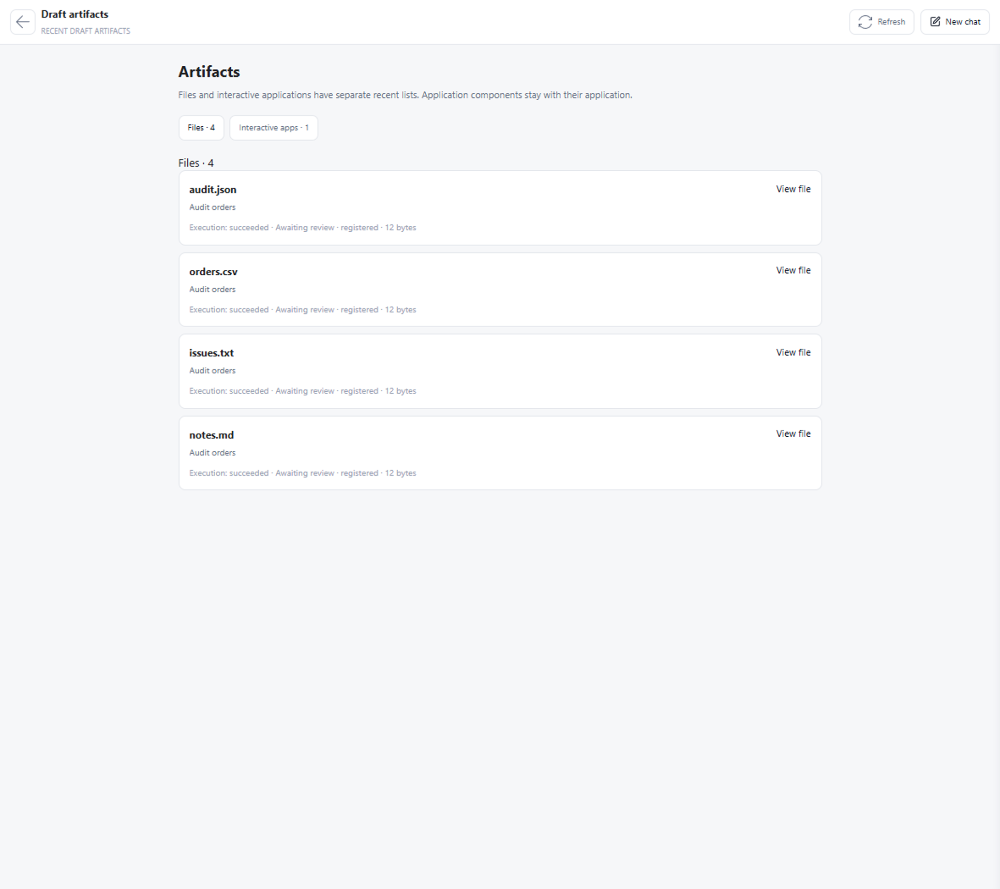

# Work files and interactive applications

Work outputs share one Host ledger. The artifact panel separates ordinary files
from verified AUIP applications, with independent counts and recent lists.
A report delivered beside an application remains an ordinary file. Application
details list the exact verified entry, manifest and Host-receipted members.

Only a current artifact revision can be previewed. The Host checks the WorkItem,
workspace containment and registered SHA-256 before returning at most 512 KiB
of UTF-8 JSON, CSV, TSV, Markdown or text. The renderer displays escaped text.
Viewing does not accept the WorkItem or execute HTML.

AUIP Open/Interact retains the manifest, entry and session Attach checks. A file
without a matching registered digest cannot become a runnable application.
An invalid app revision leaves its files visible for diagnosis. Unclaimed files
are not hidden merely because they share a directory or code suffix with an app.

Provider declarations remain evidence under Provider identities; they cannot
mint or replace Host business-file/export receipts. An accepted recovery may
inherit only unchanged hashed outputs of its direct predecessor. Unrelated
files or edits between attempts remain ambiguous.

Installed plugins are capabilities managed separately; output files do not
install plugins or grant them Host history access.

## Compatibility

There is no ledger migration or file copying. Older AUIP records without a
digest must be registered again through the Host-owned delivery path before
opening; the Host does not trust a Provider declaration as replacement proof.

## Validation and interface

`tests/test_work_artifact_preview.py`, `tests/test_work_artifact_registry.py`
and the existing AUIP recovery/export suites cover mixed delivery, causal
revisions, both recent lists, preview containment and authority boundaries.
`electron/tests/workArtifacts.smoke.mjs` exercises the production components
with synthetic data; `tools/smoke_electron_model_less.py` checks real navigation.

Previous combined view (synthetic fixture):

Independent file view:

Application and its registered members:

